# 第一次实践课：Pi Agent 安装与基础使用

姓名：周怡君　学号：202430224042

实践日期：2026 年 11 月 13—14 日。

本次实践完成了 Pi 的启动与模型配置，并进行了模型切换、文件引用、图片识别、插件使用和 PPT Skill 安装测试。

## 一、环境与启动（S1）

| 项目 | 实际结果 |
| --- | --- |
| 操作系统 | Windows / PowerShell |
| Pi 版本 | 1.5.0 |
| Node.js / npm | v24.14.1 / 11.11.0 |
| 项目目录 | pi-test |
| 接入方式 | API Key |

此前已完成 Pi 安装和命令路径配置。本次在 pi-test 目录运行 Pi，启动界面显示版本 1.5.0，以及工作目录、Skills 和 Extensions。模型通过 API 调用。

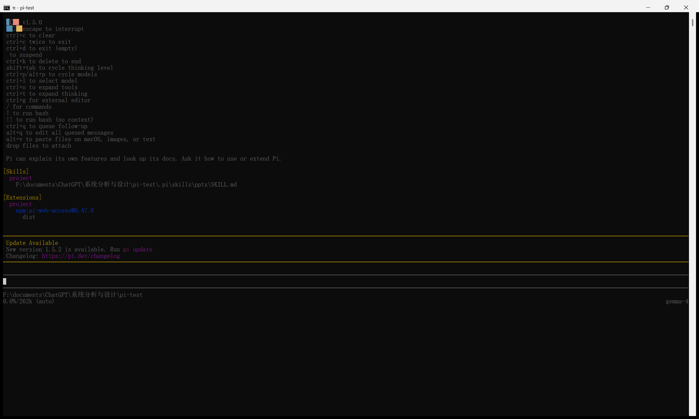

## 二、模型配置与会话（S2）

配置 API Key 后，添加 deepseek-v4-flash、qwen-3.8-27b 和 gemma-4 三个模型，并分别进行会话测试。

提示词：“你好，请用中文简短回复一句话。”

实际回复：“你好！很高兴见到你，有什么可以帮你的吗？”

模型：deepseek-v4-flash。

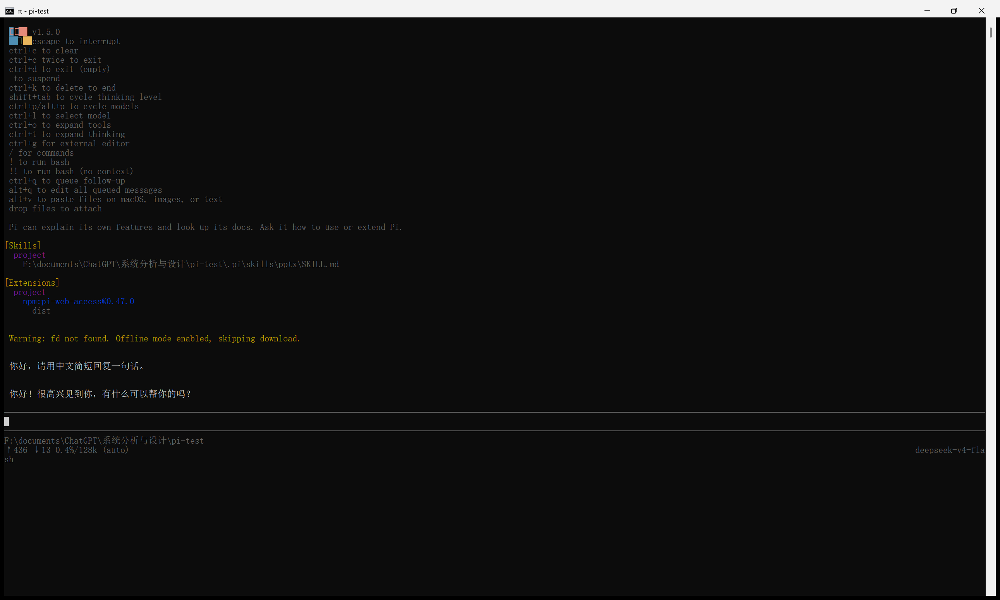

## 三、模型与思考级别切换（S3）

文件、图片实验使用 gemma-4，随后用 /model 切换至 qwen-3.8-27b；插件实验再切回 deepseek-v4-flash。通过 /thinking 将 Qwen 从 low 调到 medium，两个级别均实际完成会话。

low 提示词：Explain continuous integration in one Chinese sentence. Do not use tools.

回复说明持续集成是开发者频繁合并代码、自动构建和测试，以尽早发现并修复集成问题。

medium 提示词：Explain in one Chinese sentence why continuous integration finds errors early. Do not use tools.

实际回复：“因为持续集成要求开发者频繁地将小批量代码合并到主干，每次合并都会自动触发构建和测试，使得错误在刚被引入时就被立即发现，而不是积累很久后才在大规模集成时暴露。”

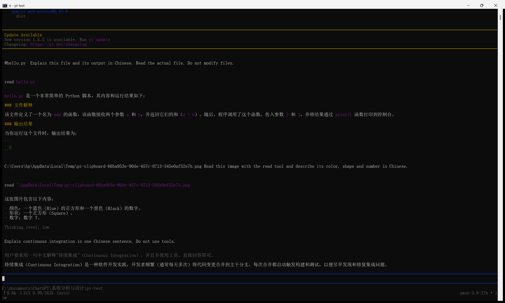

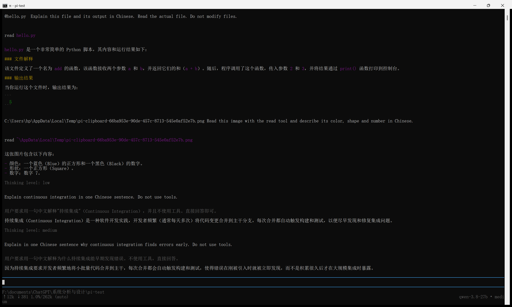

简单问答可以选择 low，涉及多步分析时可以尝试 medium。较高的思考级别可能增加等待时间和用量。本次两个级别都能正常回复；由于使用了不同问题，不能直接比较回答质量。切换思考级别时，模型仍为 qwen-3.8-27b。

## 四、文件引用与图片粘贴

### 4.1 文件引用（S4）

hello.py 内容：

~~~python
def add(a, b):
    return a + b

print(add(2, 3))
~~~

在 Pi 输入 @hello，从候选列表选中 hello.py，输入英文提示词，要求用中文解释文件功能和运行结果。

提示词：Explain this file and its output in Chinese. Read the actual file. Do not modify files.

Pi 调用 read 读取 hello.py，说明 add 函数返回两个参数之和，因此 add(2,3) 的结果为 5。运行该文件得到相同结果，输出保存在 logs/hello-output.txt。

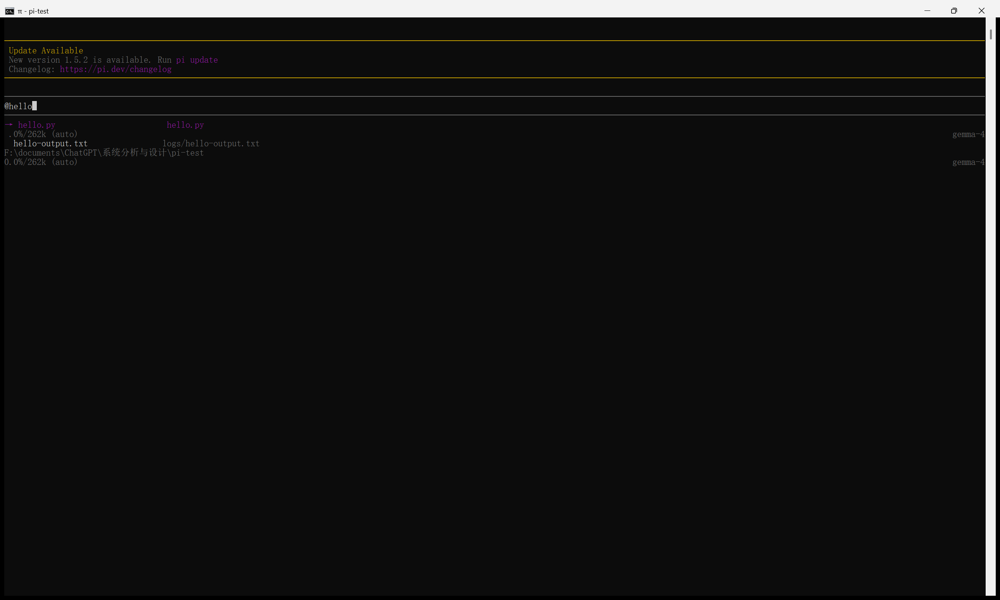

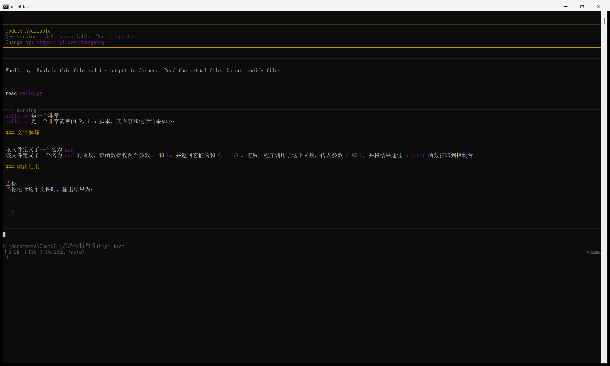

### 4.2 图片粘贴与识别（S5）

准备 200×200 像素图片，白底、蓝色正方形和黑色数字 7。

切换到支持图像输入的 gemma-4，将图片内容复制到剪贴板，在 Pi 中按 Alt+V。Pi 1.5.0 将图片保存为临时 PNG，并在输入框插入路径。随后发送提示词，让模型通过 read 读取图片并描述内容。

提示词：Read this pasted image with read and describe its color, shape and number in Chinese. No file changes.

实际回复要点：颜色为蓝色，形状为正方形，数字为 7。

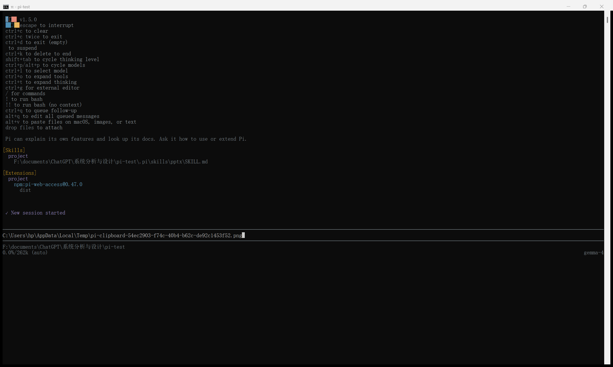

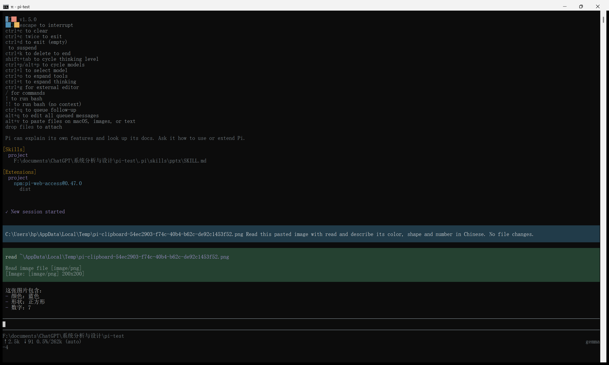

按 Ctrl+O 展开工具结果，可以看到 Read image file [image/png] 和 [Image: [image/png] 200×200]。模型识别出的颜色、形状和数字与原图一致。

## 五、插件安装、重启加载与调用（S6）

插件 pi-web-access，版本 0.47.0。来自 [Pi 官方包目录](https://pi.dev/packages)，项目为 [nicobailon/pi-web-access](https://github.com/nicobailon/pi-web-access)。

安装命令：

~~~powershell
pi install npm:pi-web-access@0.47.0 -l --approve
~~~

安装输出 added 211 packages in 32s 和 Installed npm:pi-web-access@0.47.0，记录保存在 logs/plugin-install.txt。插件采用项目级安装，配置位于 .pi/settings.json。退出 Pi 后重新启动，Extensions 列表中出现该插件，见 S1。安装结果如下。

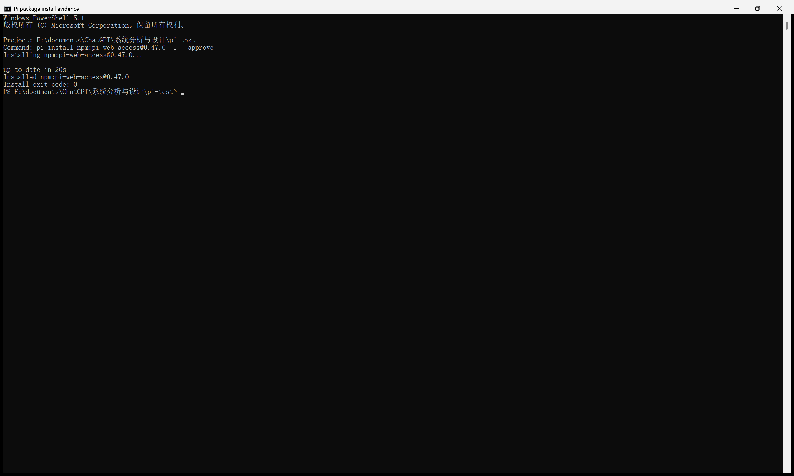

在 Pi 中要求模型使用 fetch_content，以 mode=raw 读取 [example.com](https://example.com)。工具返回 HTML，模型从 title 标签中得到页面标题 Example Domain。

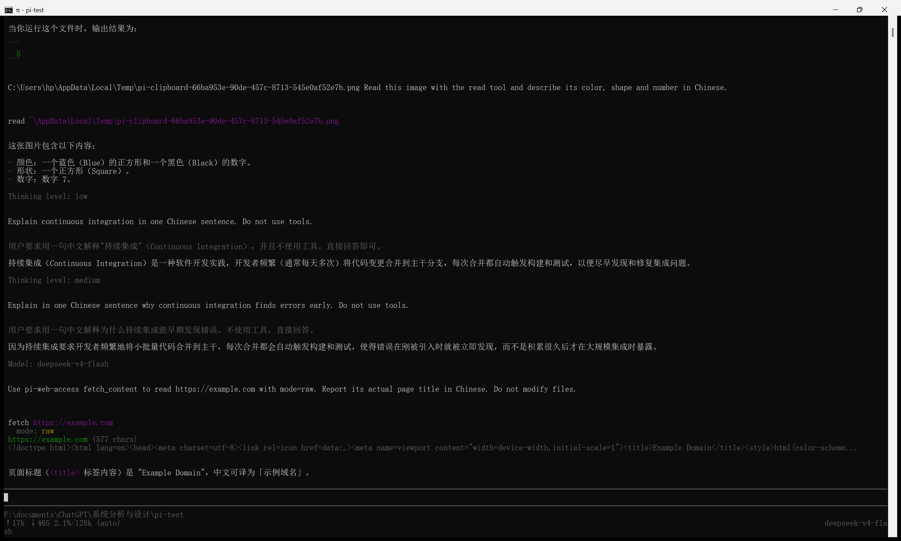

测试时 readable 模式提示正文过短，改用 raw 模式后成功读取页面。本次测试的插件功能为网页抓取。

## 六、PPT Skill（选做 S7/S8）

在 Pi 中输入安装要求，将 [anthropics/skills](https://github.com/anthropics/skills) 仓库的完整 skills/pptx 目录安装到当前项目的 .pi/skills/pptx，保留许可证和支持文件。源 commit：2c5958ecac7cee2b583967a2c4981d0f4a75c579。

Pi 调用 bash 工具，从源码压缩包提取完整目录，共 56 个文件。随后从 GitHub 下载同一 commit 的官方源码包，与安装目录逐文件比较，56 个文件全部一致，校验结果为 PASS。

源码包 SHA256：E5B0C67DBFAE471C013D0E03ABE66DB20CA70CC0C79AB6154A386C8B026E5195。

安装位置：.pi/skills/pptx，根目录包含 SKILL.md、LICENSE.txt 和 scripts；scripts 内含 thumbnail.py、add_slide.py、clean.py 及 office 等支持文件。

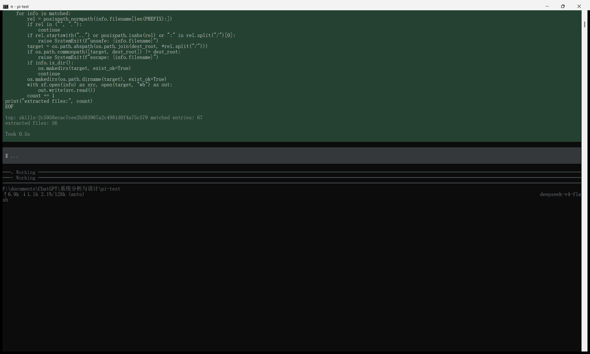

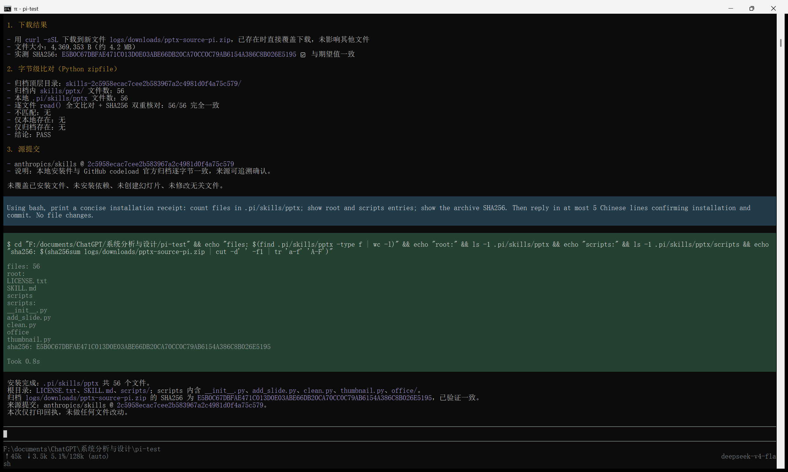

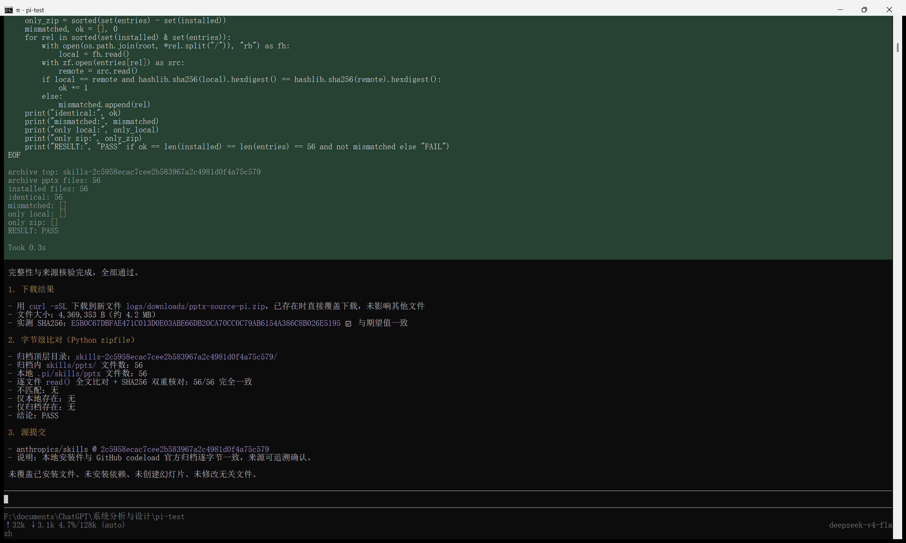

退出 Pi 并回到终端，在项目目录重新启动。启动界面的 Skills 列表显示 .pi/skills/pptx/SKILL.md。

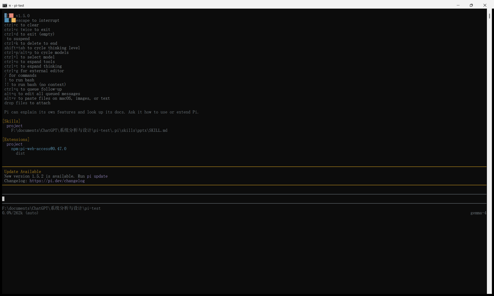

输入 /skill:pptx，要求说明技能名称、用途和所在目录。Pi 加载技能说明后，回复名称为 pptx，可用于创建、编辑和分析 .pptx 文件，项目相对目录为 .pi/skills/pptx。

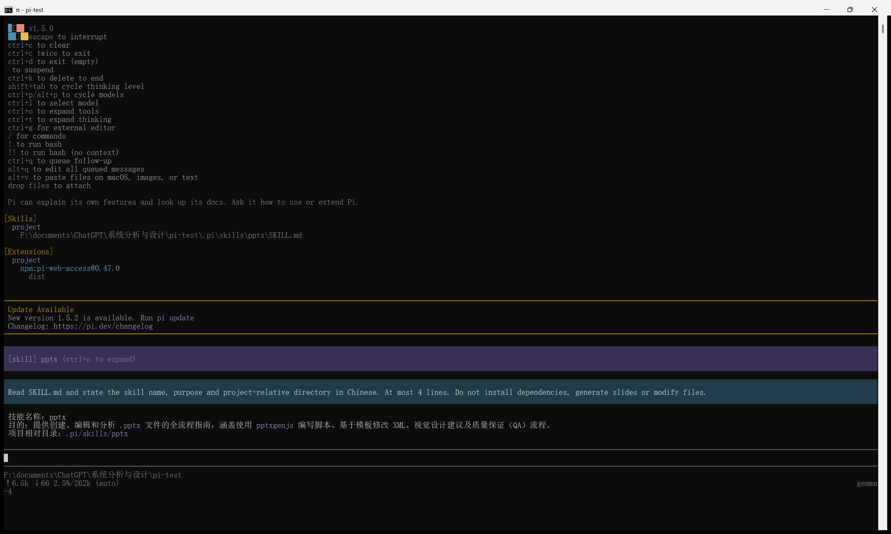

本次完成了 Skill 安装、重启加载和调用测试，未进行 PPT 文件生成。

## 七、问题与处理

| 问题 | 处理 |
| --- | --- |
| 初始无模型 | 配置模型 API 并完成实际会话 |
| fd 缺失导致无文件候选 | 正常联网启动自动准备 fd，候选恢复 |
| 中文输入出现乱码 | 使用英文提示词，并要求中文回复 |
| 文件工具未正确加载 | 检查并修正启动参数，重新启动后 read 和 fetch_content 调用成功 |
| 粘贴后只显示临时路径 | 明确要求用 read 读取图像，识别正确 |

## 八、实验结果

| 项目 | 状态 |
| --- | --- |
| S1–S3 | 启动、会话、模型及思考级别切换已完成并截图 |
| S4 | @ 候选、实际读取和输出解释已完成 |
| S5 | 剪贴板粘贴、图像类型与尺寸提示、实际识别及原图已保存 |
| S6 | 安装、重启加载与 Pi 内实际调用已完成 |
| S7/S8 | Pi 内实际安装、完整目录、官方源码校验、重启发现与调用已完成 |

本次实践中，文件解释得到了输出 5，图片识别结果为蓝色正方形和数字 7，网页读取结果为 Example Domain。模型切换、思考级别切换、插件加载和 PPT Skill 调用均完成。操作截图保存在 evidence，测试代码为 hello.py，测试原图为 assets/blue-square-7.png。

