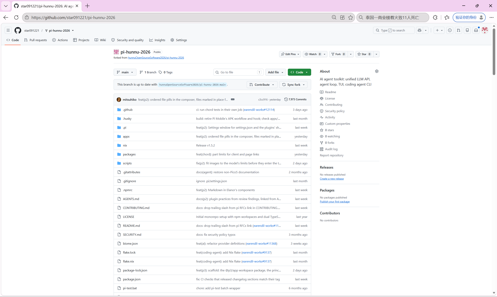
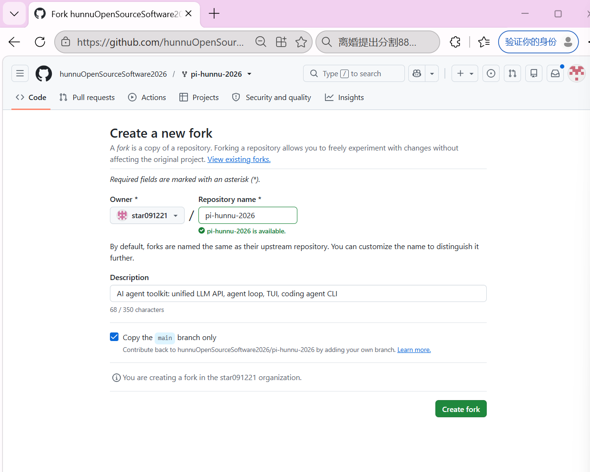
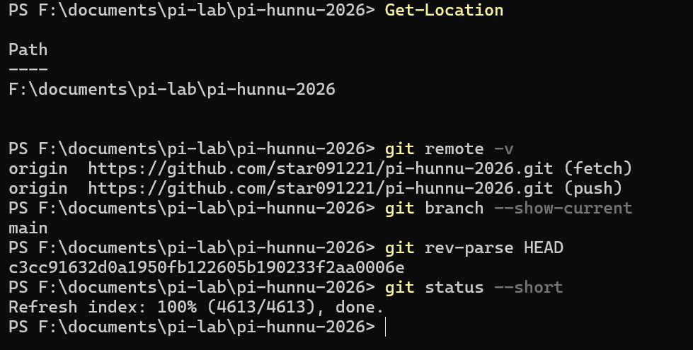
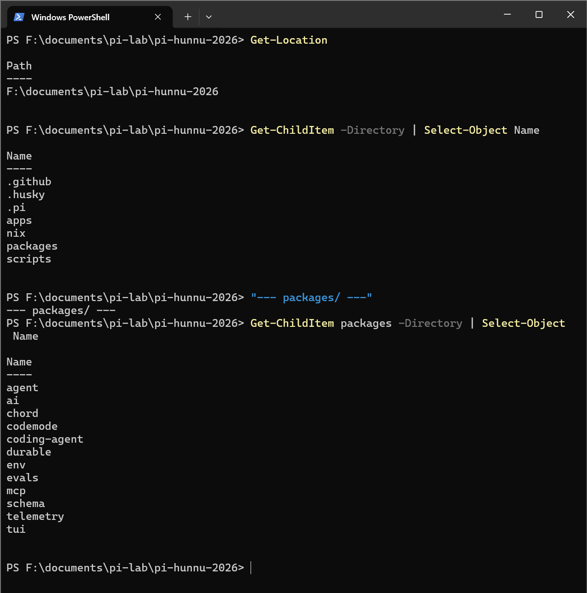
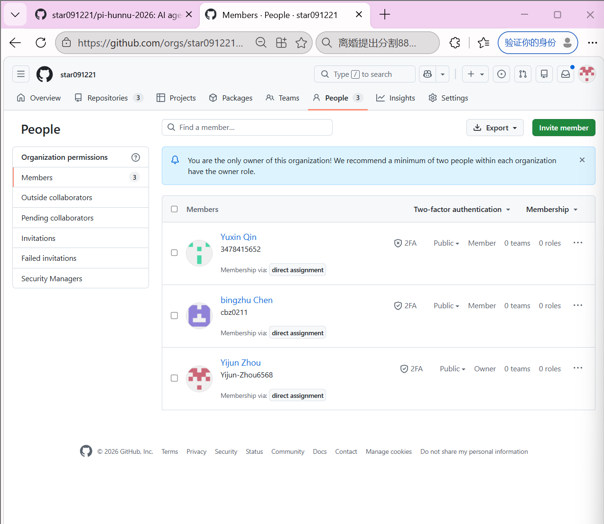
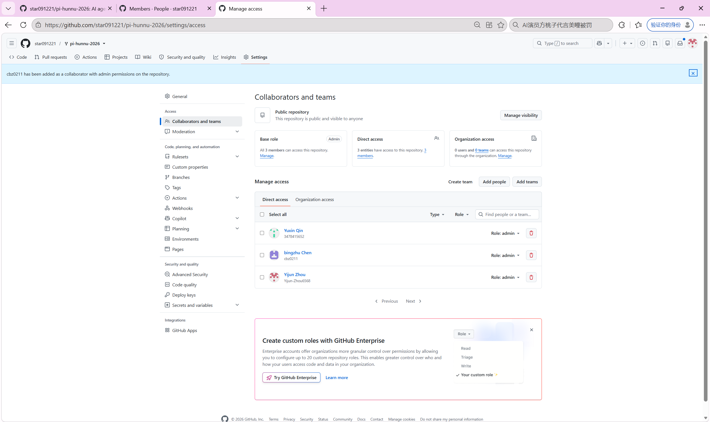
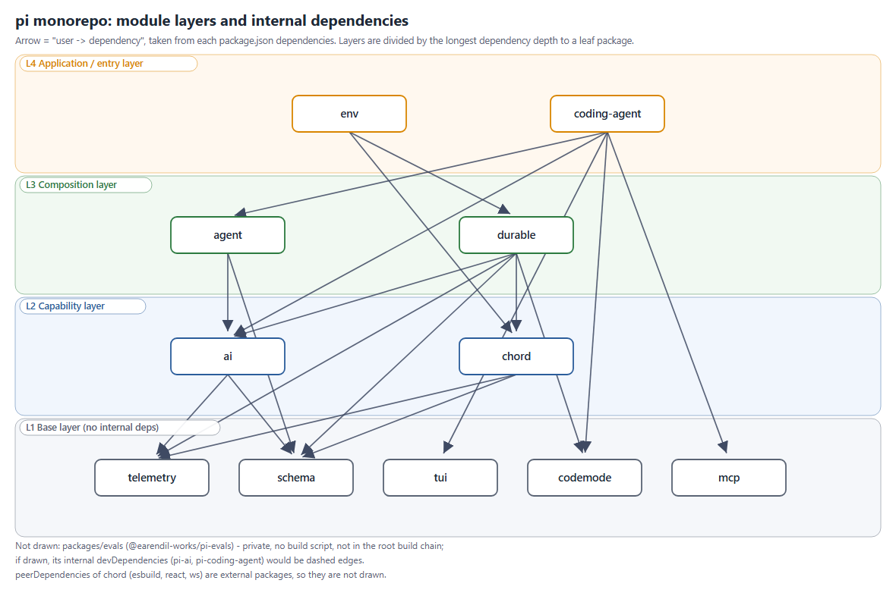
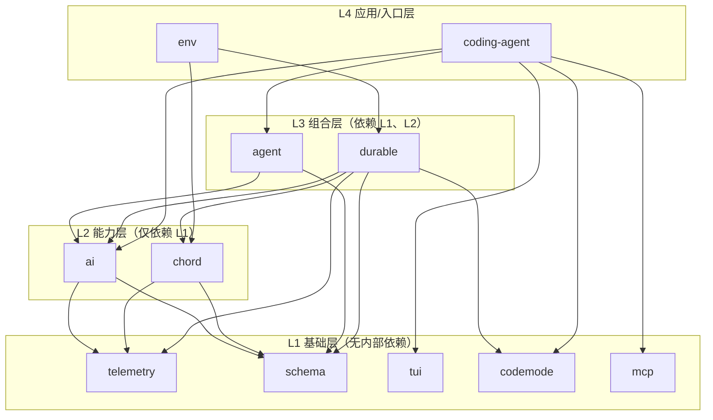

# 实践课2：组织建仓与源码分析

| 项目 | 内容 |
| --- | --- |
| 姓名 / 学号 | 周怡君 / 202430224042 |
| 姓名拼音（用于 Issue 标题） | Zhou Yijun |
| 小组组织 | star091221 |
| 小组代码仓库 | https://github.com/star091221/pi-hunnu-2026 |
| 本人重点分析的模块 | ai、agent、coding-agent |
| 源码 commit | c3cc91632d0a1950fb122605b190233f2aa0006e |
| Node 版本 | v24.14.1 |

---

## 一、源码获取

### 1. 小组组织仓库



仓库已 fork 至小组组织 `star091221`，页面显示 `forked from hunnuOpenSourceSoftware2026/pi-hunnu-2026`，当前分支为 `main`，且提示 `This branch is up to date with hunnuOpenSourceSoftware2026/pi-hunnu-2026:main`，说明 fork 关系正常。

| 项目 | 内容 |
| --- | --- |
| 仓库归属 | 小组组织 `star091221`（非教师组织，非个人账号） |
| 仓库地址 | https://github.com/star091221/pi-hunnu-2026 |
| 上游仓库 | https://github.com/hunnuOpenSourceSoftware2026/pi-hunnu-2026 |
| 可见性 | Public |

fork 创建页（Owner 选择小组组织、仓库名保留 `pi-hunnu-2026`）作为过程记录附上：



### 2. 本人 clone 与版本核验（S1）



| 项目 | 实际值 |
| --- | --- |
| 本地路径 | `F:\documents\pi-lab\pi-hunnu-2026`（全英文路径） |
| origin（fetch） | https://github.com/star091221/pi-hunnu-2026.git |
| origin（push） | https://github.com/star091221/pi-hunnu-2026.git |
| 当前分支 | main |
| commit（完整） | c3cc91632d0a1950fb122605b190233f2aa0006e |
| 工作区状态 | 干净，无未提交改动 |
| Node 版本 | v22.23.2（根 `package.json` 要求 `>=22.19.0`） |

### 3. 源码目录结构



根 `package.json` 声明为私有 monorepo（`name: pi-monorepo`、`private: true`），由 npm workspaces 管理：`workspaces` 为 `packages/*`、`apps/*`，外加载荷示例目录 `packages/chord/test/examples/61-tutorial`、`packages/coding-agent/examples/extensions/{with-deps, custom-provider-anthropic, gondolin}`。本次构建涉及的 11 个模块全部位于 `packages/` 下。

### 4. 组员与组织成员



组织内共 3 名成员：`Yijun Zhou`（Owner）、`Yuxin Qin`、`bingzhu Chen`（Member），三人都已开启 2FA，成员关系均为 direct assignment（直接加入组织）。

### 5. 仓库访问权限



`Settings → Collaborators and teams` 显示：Base role 为 Admin（"All 3 members can access this repository"），Direct access 3 entities / 3 members，三名成员的角色均为 admin。组员已具备后续共同开发所需的仓库读写权限。

---

## 二、模块分析

### 1. 构建顺序

根 `package.json` 的 `scripts.build` 是一条 `cd` 串联命令，按下列顺序依次在 11 个子包中执行 `npm run build`：

```
telemetry → schema → chord → tui → codemode → mcp → ai → durable → env → agent → coding-agent
```

- `build` 与 `build:offline` 逐段比对，**只有** `ai` **这一段不同**：`build` 里是 `cd ../ai && npm run build`，`build:offline` 里是 `cd ../ai && npm run build:offline`；其余 10 段的 `cd ... && npm run build` 完全一致。
- 根 `workspaces` 覆盖 `packages/*` 与 `apps/*`，但 `scripts.build` 只显式列出 `packages/` 下的 11 个模块，不包含 `apps/`。
- 根目录存在 `tsconfig.json`，但它是 `"noEmit": true` 的全仓类型检查配置（用 `paths` 把各包名映射到 `src/**`），服务于 `npm run check`，**不参与** `npm run build`。

### 2. 模块分析表

| 子文件夹 | 代码主要实现什么功能 | 本模块 build 执行什么、生成什么 | 直接依赖哪些内部模块 | 依据文件或代码位置 |
| --- | --- | --- | --- | --- |
| `telemetry` | 定义与厂商无关的追踪/指标契约：回调式 `TelemetryContext` / `TelemetrySpan` 接口、共享 `NOOP_TELEMETRY_CONTEXT`、跨进程传播与 span link、计数器/上下计数器/直方图以及带类型推导的指标 schema，并提供内存版参考实现；它是全仓埋点的公共底座，自身不依赖任何内部包 | `tsc -p tsconfig.build.json`：读取本包 `tsconfig.build.json`（extends `../../tsconfig.base.json`，`outDir=./dist`、`rootDir=./src`、`include: src/**/*.ts`），把 `src/` 编译到 `dist/`，产出 `.js` + `.d.ts` + `.d.ts.map` + `.js.map`（base 里 `declaration`/`declarationMap`/`sourceMap` 均为 true）；产物由 `main`/`types` 及 `exports` 的 `.`、`./render`、`./testing` 三个入口暴露 | 无 | `packages/telemetry/package.json`（`scripts.build`、`files`、`exports`）；`packages/telemetry/tsconfig.build.json`；`README.md` |
| `schema` | JSON Schema 构建器 + 不经 `eval` 的校验器：schema 一次编译成普通闭包，因此在严格 CSP 环境下也能以接近"代码生成式"校验器的速度校验；支持 draft 2020-12 与 draft 7，错误以 JSON Pointer 路径报出且不修改原 schema；零运行时依赖，压缩后约 8.5 KB，格式校验是可选子入口 | `tsc -p tsconfig.build.json`：同构的 `outDir`/`rootDir` 配置，编译 `src/` 到 `dist/`，产出 `.js`/`.d.ts`（含 map）；`exports` 暴露 `.` 与 `./formats`；另有 `bench` 脚本（不在构建链内） | 无 | `packages/schema/package.json`（`scripts`、`files`、`exports`）；`packages/schema/tsconfig.build.json`；`README.md` |
| `chord` | 跨进程对象运行时：对象类型即契约（名字、选择实例的参数、宿主、成员、版本，契约用 `pi-schema` 的构建器以 JSON Schema 描述）；facet 是插件对某一宿主的声明，工厂只声明、由 Chord 激活；使用方拿到的是"引用"而非对象本身；提供事务式文档存储、derives、jobs、principal 隔离，以及插件热重载；并给出 HTTP、workers、Web/React、终端等宿主与客户端 | `tsc -p tsconfig.build.json`：编译 `src/` 到 `dist/`；因能力面很大，`exports` 拆出 20 余个子入口（`./sqlite`、`./http`、`./workers`、`./plugins`、`./web`、`./react`、`./tui`、`./sync`、`./telemetry-ingest` 等），构建时一次 `tsc` 产出全部入口的 `.js`/`.d.ts` | `pi-schema`、`pi-telemetry` | `packages/chord/package.json`（`name` 为 `@earendil-works/chord`，`dependencies`、`exports`）；`README.md`；`docs/design.md` |
| `tui` | 终端 UI 框架：差分渲染（只重绘变化的行/视口行）、CSI 2026 同步输出避免闪烁、备用屏视口由应用自主滚动（支持鼠标/触控板/键盘）、组件化的 `Component.render()`、括号粘贴模式；另有各平台原生剪贴板模块（`native/`） | `tsc -p tsconfig.build.json` 编译 `src/` 到 `dist/`；原生部分是**独立脚本** `build:native:win32` / `build:native:darwin` / `build:native:linux`（分别调用 `native/win32/build.mjs` 与 shell 脚本），产物为 `native/*/prebuilds/*.node`，**不进入根** `build` **链** | 无（运行时依赖 `get-east-asian-width`、`marked`、`marked-cjk-friendly` 均为外部包） | `packages/tui/package.json`（`scripts`、`files`）；`README.md` |
| `codemode` | 在 QuickJS（编译为 WebAssembly）沙箱中执行模型编写的 JavaScript，脚本唯一能力是调用注入的工具；嵌套工具调用不进入 LLM 上下文，只有脚本输出/返回值回到模型；两套沙箱（Node 用 `CodemodeSandbox` 走 worker 线程，Cloudflare 用 `RemoteCodemodeSandbox` 走 Durable Object）共享同一套 API、脚本环境和结果格式 | `tsc -p tsconfig.build.json` 编译 `src/` 到 `dist/`；`exports` 暴露 `.`、`./declarations`、`./source`、`./portable`、`./cloudflare`、`./worker` 六个入口 | 无（仅外部依赖 `quickjs-wasi`） | `packages/codemode/package.json`（`dependencies`、`exports`）；`README.md` |
| `mcp` | 独立的小型 MCP（Model Context Protocol）客户端：与传输无关的 client core，内置 stdio、Streamable HTTP、指向别处已启动程序的管道 stdio，以及内存测试传输；不依赖官方 MCP SDK，也不依赖其他 pi 包 | `tsc -p tsconfig.build.json` 编译 `src/` 到 `dist/`；`exports` 暴露 `.`、`./oauth`、`./testing` | 无（仅外部依赖 `cross-spawn`） | `packages/mcp/package.json`（`dependencies`、`exports`）；`README.md` |
| `ai` | 统一 LLM API：多 provider 集合、自动鉴权解析、token 与成本统计、上下文持久化，以及会话中途把上下文交给另一个模型的 hand-off；模型目录只收录支持工具调用（function calling）的模型，因为这是 agent 工作流的前提 | `npm run generate-models && npm run build:offline`。第一步 `generate-models` 执行 `node catalog/generate.ts --strict`，从 `catalog/` 生成各 provider 的模型目录数据；第二步 `build:offline` = `check:model-data`（用 `scripts/check-model-data.ts` 校验模型数据）→ `tsc -p tsconfig.build.json` 编译到 `dist/` → 清空 `dist/providers/data` 后再把 `src/providers/data` 整目录复制进 `dist/providers`（JSON 数据不经过 `tsc`，必须单独拷贝），最终 `dist/` 里是代码 + 模型数据 | `pi-schema`、`pi-telemetry` | `packages/ai/package.json`（`scripts.build`、`scripts.build:offline`、`scripts.generate-models`、`dependencies`）；`README.md`；`catalog/generate.ts` |
| `durable` | 持久化 agent 框架（自述为实验性）：对话、模型轮次、工具调用与自定义状态在展示之前先提交存储，进程中途死亡后重新打开存储即可从断点续跑；死在模型请求中途的一次被计为失败尝试并重试，反复杀死进程的请求会被终止；模型访问基于 `pi-ai`，文档状态基于 `chord` | `tsc -p tsconfig.build.json` 编译 `src/` 到 `dist/`；`exports` 按能力拆分（`./env`、`./codemode`、`./tool-search`、`./tools`、`./images/*`、`./storage/*` 含 memory/indexeddb/jsonl/sqlite、`./testing` 等）；测试脚本繁多（`test:store`、`test:workers` 与多个 `bench:*`），均不参与构建 | `chord`、`pi-ai`、`pi-codemode`、`pi-schema`、`pi-telemetry` | `packages/durable/package.json`（`scripts`、`dependencies`、`exports`）；`README.md` |
| `env` | 为 Durable 提供远程执行环境：远端机器上运行一个小的 Rust 守护进程（`daemon/`，走 stdin/stdout 的分帧协议执行文件操作与命令），本地侧提供 `RemoteExecutionEnv`（Durable 的 `ExecutionEnv` 实现）经 `Connection` 调用它，结果与本地 `NodeExecutionEnv` 对齐 | `tsc -p tsconfig.build.json` 编译 `src/` 到 `dist/`；原生守护进程由独立脚本 `build:daemon`（`cargo build --manifest-path daemon/Cargo.toml --locked`）产出，**不进入根** `build` **链**；`files` 发布 `dist`、`bin`、`docs` | `chord`、`pi-durable` | `packages/env/package.json`（`scripts.build`、`scripts.build:daemon`、`dependencies`、`files`）；`README.md`；`docs/protocol.md` |
| `agent` | 有状态 agent 核心：工具执行与事件流（传输层抽象、状态管理、附件支持），建立在 `pi-ai` 之上 | `tsc -p tsconfig.build.json` 编译 `src/` 到 `dist/`；`exports` 仅 `.` 与 `./package.json` 两个入口；`prepublishOnly` 只执行 `npm run build`（该包没有 `clean` 步骤） | `pi-ai`、`pi-schema` | `packages/agent/package.json`（`name` 为 `@earendil-works/pi-agent-core`，`scripts`、`dependencies`）；`README.md` |
| `coding-agent` | 编码助手 CLI：内置 read/bash/edit/write 工具与会话管理，把 agent 核心、`pi-ai`、`pi-tui`、`pi-mcp`、`pi-codemode` 组装成可执行命令行程序，同时导出 `rpc-entry` 供 RPC 模式使用 | `npm run build:unbundled && node ../../scripts/build-coding-agent-bundle.mjs`。`build:unbundled` = `tsc -p tsconfig.build.json` 编译到 `dist/` → 用 `scripts/package-files.mjs executable` 给 `dist/cli.js`、`dist/rpc-entry.js` 加上可执行包装 → `copy-assets` 把交互主题 JSON、PNG 资源、导出 HTML 的 `template.html/css/js` 与 `vendor/*.js` 复制进 `dist/`；随后 bundle 脚本再把产物打成发布用单文件（另有 `build:binary` 走 bun 编译成独立二进制，不在链内） | `pi-agent-core`、`pi-ai`、`pi-codemode`、`pi-mcp`、`pi-tui` | `packages/coding-agent/package.json`（`scripts.build`、`scripts.build:unbundled`、`scripts.copy-assets`、`dependencies`）；`scripts/build-coding-agent-bundle.mjs` |

**与作业给定清单的差异说明：**

- `packages/` 下实际有 **12 个**目录，比清单多出 `evals`（`@earendil-works/pi-evals`，`private: true`）。它**没有** `scripts.build`、没有 `main`/`types`，只有 `clean`/`eval`/`test` 等脚本，且**不在根** `build` **链中**，属于评测工作区而非构建模块；它把 `pi-ai`、`pi-coding-agent` 放在 `devDependencies` 里——这也是全仓唯一出现"内部开发依赖"的地方。
- `apps/` 下有 `p2`、`p2-mac`、`p3` 三个目录（`p2`、`@p3/app` 均 `private: true`，只有 `start`/`dev`/`check`/`test` 之类脚本；`p2-mac` 没有 `package.json`）。三者都被 `workspaces: apps/*` 纳入工作区，但**都没有** `build` **脚本、都不在根** `build` **链中**，因此不作为本次分析的构建模块。
- 清单中 11 个模块在本人版本中**全部存在，没有缺失**；`packages/chord` 的包名为 `@earendil-works/chord`（不带 `pi-` 前缀），`packages/agent` 的包名为 `@earendil-works/pi-agent-core`——**目录名与包名并不总是一致**，表中依赖一律以 `package.json` 的 `name` 为准。

### 3. 依赖关系图



- 图源文件：`docs/deps.mmd`（Mermaid；可直接导入 mermaid.live / draw.io 再编辑），矢量版为 `images/deps-relation.svg`，报告内引用的是 `images/deps-relation.png`。
- **图例**：实线箭头 = 运行时直接依赖（取自各包 `dependencies`）；虚线箭头 = 开发依赖或可选依赖（取自 `devDependencies` / `optionalDependencies`）；箭头一律由**使用方**指向**被依赖方**。
- **层级划分依据**：按"该包到叶子包的最长依赖深度"分层——L1 为不依赖任何内部包的叶子包；L2 只依赖 L1；L3 依赖 L1、L2；L4 为面向用户的应用/入口层（自身被依赖次数最少）。



> 说明：11 个模块的 `dependencies` 中，除上图的边之外没有其他内部依赖；`chord` 的 `peerDependencies`（`esbuild`、`react`、`ws`）均为外部包，未画入图中。内部开发依赖只出现在 `packages/evals`（`pi-ai`、`pi-coding-agent`），该包不在构建链内，故用注释标注而不入图的主体。

### 4. 三个问题

**（1）根目录与子模块中的** `npm run build` **分别读取什么配置、执行什么工作？**

- **根目录**：入口是根 `package.json` 的 `scripts.build` / `scripts.build:offline`。它**不读任何** `tsconfig`，本质是一条用 `cd` + `&&` 串起来的 shell 调用链，按固定顺序在每个子包目录里执行一次 `npm run build`（`build:offline` 只把 `ai` 换成了 `build:offline`）。根目录本身**不产出构建物**，`dist/` 分散在各子包内；根 `tsconfig.json`（`noEmit: true`，用 `paths` 把各包名指向 `src/**`）只服务于 `npm run check` 的全仓类型检查，与 `build` 无关。
- **子模块**：入口是 `packages/<模块>/package.json` 的 `scripts.build`。多数模块是 `tsc -p tsconfig.build.json`——读取本包的 `tsconfig.build.json`（`extends ../../tsconfig.base.json`，`outDir: ./dist`、`rootDir: ./src`、`include: src/**/*.ts`），把 `src/` 编译成 `dist/` 下的 `.js`、`.d.ts`、`.d.ts.map`、`.js.map`（base 中 `declaration`/`declarationMap`/`sourceMap` 为 true），产物路径由 `package.json` 的 `main`、`types` 和 `exports` 指回 `dist`。少数模块在此之上有额外步骤：`ai` 先 `generate-models` 生成并 `check:model-data` 校验模型目录，再在 `tsc` 之后复制 `src/providers/data`（JSON 不走编译器）；`coding-agent` 在 `tsc` 之后再执行"加可执行包装 + 拷贝主题/图片/HTML 模板"的 `copy-assets`，最后由 bundle 脚本打出单文件发布版。

**（2）构建顺序和模块依赖有什么关系？相邻构建的模块是否一定互相依赖？**

- 顺序实质上是**依赖拓扑序的一种手工实现**：根 `build` 的 11 段顺序保证每条依赖边上的"被依赖方"都先构建。这一点的机制依据是——各包 `tsconfig.build.json` 只 `extends` `tsconfig.base.json`（其中没有根 `tsconfig.json` 的 `paths` 映射），因此跨包导入会经 workspaces 软链、按各包 `exports` 的 `types`/`import` 条件解析到对方的 `dist/*.d.ts` 与 `dist/*.js`；下层没先产出 `dist`，上层 `tsc` 就会找不到类型或模块。`ai` 之所以在 `build:offline` 中单独替换，也说明顺序承载的不只是"先后"，还包括该包自身的离线数据准备需求。
- **相邻不等于互相依赖**。顺序只保证"边指向正确"，不保证"相邻两格之间存在边"。反例就在链上：`tui` 与 `codemode` 前后相邻，但两者之间没有任何依赖关系（`tui` 零内部依赖，`codemode` 只依赖外部 `quickjs-wasi`），把它们排在这里只是为了让顺序整体满足拓扑约束；同理 `mcp` 与 `ai`、`env` 与 `agent` 也相邻而无依赖边。反过来，非相邻的两个模块也可能存在依赖，例如 `durable` 依赖排在第 1、2 位的 `telemetry` 与 `schema`。

**（3）选择一条涉及至少三个模块的依赖路径，说明这些模块如何分工**

取路径 `coding-agent → agent → ai → schema`（四跳三模块，全部来自 `dependencies`；`agent` 指包 `@earendil-works/pi-agent-core`）：

- `coding-agent`**（**`@earendil-works/pi-coding-agent`**）**：最上层的用户入口，负责"把能力拼成一个能用的命令行工具"——提供 read/bash/edit/write 等内置工具与会话管理，依赖 `pi-agent-core` 拿 agent 循环、依赖 `pi-ai` 拿模型、依赖 `pi-tui` 渲染终端界面、依赖 `pi-mcp` 接外部工具、依赖 `pi-codemode` 执行模型写的脚本；构建上也最特殊（可执行包装 + 资源拷贝 + bundle）。
- `agent`**（**`@earendil-works/pi-agent-core`**）**：中间的 agent 执行核心，负责"一次任务怎么跑"——状态管理、工具执行、事件流与传输层抽象、附件处理，把模型的返回变成可执行的动作序列；它不关心界面与进程形态，也不直接实现模型协议，只向上暴露一套与传输无关的 API。
- `ai`**（**`@earendil-works/pi-ai`**）**：模型访问层，负责"怎么和各家大模型说话"——统一多 provider 的请求/响应、自动鉴权、token 与成本统计、上下文持久化与会话中途切换模型；它把各厂商差异收敛成一套接口供 `agent` 调用。
- `schema`**（**`@earendil-works/pi-schema`**）**：最底层的校验原语，负责"参数长什么样才算合法"——提供 JSON Schema 构建器与无 `eval` 的高性能校验器，`ai`/`agent` 用它约束工具入参和结构化输出，因此处在链路末端、被依赖但不依赖任何内部包。

---

## 三、附件与源文件

| 文件 | 说明 |
| --- | --- |
| `images/github-fork-page.png` | fork 创建页（Owner 选小组组织） |
| `images/github-org-repo.png` | 小组组织仓库首页 |
| `images/s1-clone.png` | clone 与版本核验（S1） |
| `images/src-tree.png` | 本地源码目录截图 |
| `images/org-people.png` | 组织成员 |
| `images/repo-access.png` | 仓库访问权限 |
| `images/deps-relation.png` | 依赖关系图（PNG 版，报告中引用） |
| `images/deps-relation.svg` | 依赖关系图（矢量版） |
| `docs/deps.mmd` | 依赖关系图图源（Mermaid，可导入 mermaid.live / draw.io 编辑） |

## 四、参考

- 课程仓库：https://github.com/hunnuOpenSourceSoftware2026/pi-hunnu-2026
- 各模块 `README.md`、`docs/design.md`（chord）、`docs/protocol.md`（env）
- 根 `package.json`、根 `tsconfig.json` / `tsconfig.base.json`、各包 `package.json` 与 `tsconfig.build.json`