# 实践课3：Pi Agent 源码安装与编译

| 项目 | 内容 |
| --- | --- |
| 姓名 / 学号 | 周怡君 / 202430224042 |
| 姓名拼音（用于 Issue 标题） | Zhou Yijun |
| 小组组织 | star091221 |
| 小组代码仓库 | https://github.com/star091221/pi-hunnu-2026 |
| 本地源码路径 | `F:\documents\pi-lab\pi-hunnu-2026` |
| 源码 commit | c3cc91632d0a1950fb122605b190233f2aa0006e |
| 分支 | main |
| Node.js / npm | v24.14.1 / 11.11.0 |
| Git | 2.51.1.windows.1 |
| 构建产物版本 | 1.5.2 |

---

## 一、任务一 实验准备：检查和记录开发工具

### 1. 版本检查

在 PowerShell 中逐条执行 `node --version`、`npm --version`、`git --version`，并追加一条 `node -e "console.log('Hello, Node.js!')"` 验证 Node 能正常执行脚本。

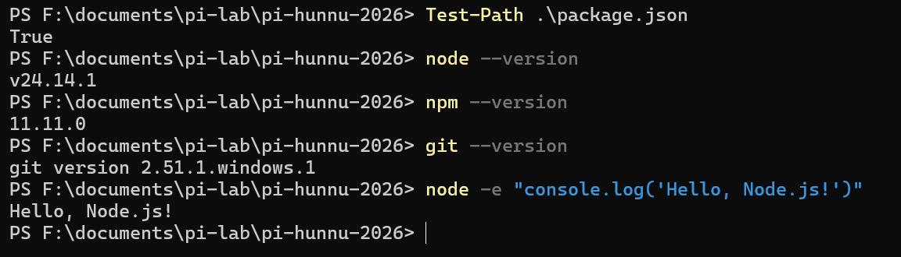

*图 S1 环境检查：*`Test-Path .\package.json` *为 True，Node v24.14.1、npm 11.11.0、git 2.51.1.windows.1，*`Hello, Node.js!` *正常输出。*

| 工具 | 实际版本 | 本次用途 | 是否满足要求 |
| --- | --- | --- | --- |
| Node.js | v24.14.1 | 运行构建脚本与 CLI | 满足 `engines.node >= 22.19.0`，且属于课程建议的 Node 24 LTS |
| npm | 11.11.0 | 安装依赖、执行 scripts | 随 Node 附带，未单独安装 |
| Git for Windows | 2.51.1.windows.1 | 管理源码 | `git --version` 正常 |
| 编辑器 | VS Code | 查看 `package.json`、`tsconfig.build.json` | — |

**版本要求从哪里来：** 根 `package.json` 的 `engines` 字段声明 `"node": ">=22.19.0"`，这是项目的最低门槛；课程据此建议统一到 Node 24 LTS，因为旧环境（Node 22）安装时曾触发依赖 `@earendil-works/gondolin` 要求 `>=23.6.0` 的 `EBADENGINE` 警告。本次使用 v24.14.1，安装阶段没有再出现任何 `EBADENGINE`（见任务四）。

由于本机 Node 已为 24 系列，本次未安装新版本，也未使用 fnm 切换，因此没有额外截图。

---

## 二、任务二 源码获取与版本确认

源码为第二次实践课已在小组组织内 fork 的仓库，本地已有可用克隆，本次继续使用该目录，未重新 clone，也未覆盖任何已有文件。

```powershell
Get-Location
git remote -v
git branch --show-current
git rev-parse HEAD
git status --short
```

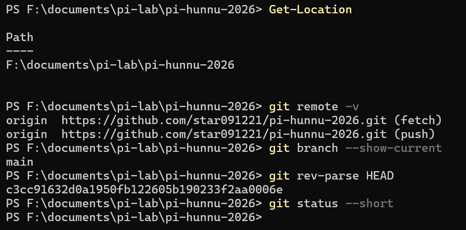

*图 S2 路径为* `F:\documents\pi-lab\pi-hunnu-2026`*，*`origin`*（fetch 与 push）均指向* `https://github.com/star091221/pi-hunnu-2026.git`*，分支* `main`*，完整 commit 为* `c3cc91632d0a1950fb122605b190233f2aa0006e`*，*`git status --short` *无输出即工作区干净。*

这一步的意义在于“源码确实落到了本地磁盘”：`Get-Location` 给出绝对路径，`git rev-parse HEAD` 给出可复核的提交编号，二者都不是打开 GitHub 网页能替代的。后续所有安装、构建命令都在这个目录执行。

---

## 三、任务三 阅读配置，确认安装与编译的依据

用 VS Code 打开仓库根目录，重点看 `README.md` 的 Development 小节、根 `package.json`、`package-lock.json`、`packages/` 目录和 `packages/coding-agent/package.json`。

### 1. `engines.node` 的位置

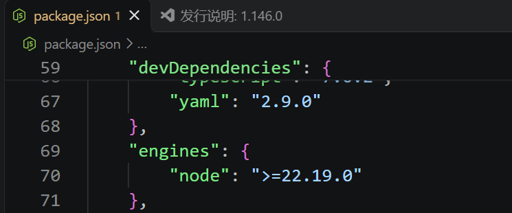

*图 S3-1* `package.json` *第 69–71 行：*`"engines": { "node": ">=22.19.0" }`*。*

回答作业的问题：**Node.js 版本要求写在仓库根目录** `package.json` **的** `engines.node` **字段里，不是 README、不是 npm 全局配置，也不在某个子包的配置中。** 根项目只规定下限，各工作区依赖还可能声明更高的要求，所以实际选版本时要同时核对安装日志。

### 2. `scripts.build` 的定义

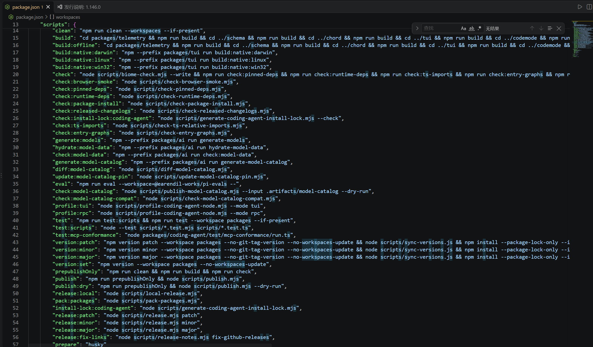

*图 S3-2* `scripts` *中第 15 行* `build`*、第 16 行* `build:offline`*。*

`build` 是一条用 `cd` + `&&` 串起来的命令链，按 11 段依次进入子包执行各自的 `npm run build`：

```
telemetry → schema → chord → tui → codemode → mcp → ai → durable → env → agent → coding-agent
```

`&&` 表示前一步成功后才会执行下一步，因此任何一段失败都会让整条链中止（本次就在 `ai` 段被中止，见任务五）。`build:offline` 与 `build` 唯一的差异是 `ai` 那一段从 `npm run build` 换成了 `npm run build:offline`，其余 10 段完全一致。

回答作业的问题：`npm run build` **不在 npm 层面执行统一的“编译动作”，它只是去读当前目录** `package.json` **的** `scripts.build` **字段，把字段里的字符串交给 shell 执行。** 真正的编译发生在子包：多数包执行 `tsc -p tsconfig.build.json`，把本包 `src/` 编译到 `dist/`；`ai` 还多两步（生成/校验模型目录数据、把 `src/providers/data` 的 JSON 拷贝进 `dist`），`coding-agent` 还多两步（给入口加可执行包装、拷贝主题与模板资源），最后由 `scripts/build-coding-agent-bundle.mjs` 打成单文件。根目录存在 `tsconfig.json`，但它是 `noEmit: true` 的全仓类型检查配置，只服务 `npm run check`，不参与构建。

### 3. workspaces 带来的安装约束

仓库用 npm workspaces 管理 `packages/*` 与 `apps/*`，`package-lock.json` 在根目录统一锁定版本。因此依赖必须从根目录安装、按根脚本顺序构建，**不能给每个子包单独安装再各自生成锁文件**，否则会出现多份互相矛盾的锁文件。

---

## 四、任务四 安装项目依赖

### 1. 执行安装

```powershell
npm install --ignore-scripts
$LASTEXITCODE
```

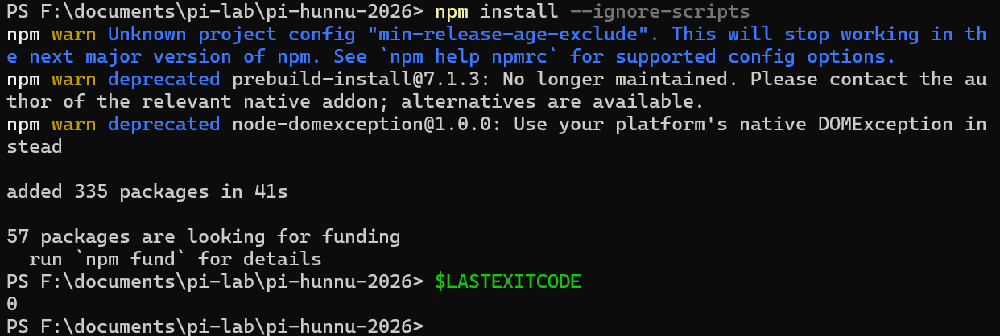

*图 S4* `added 335 packages in 41s`*，随后手动执行* `$LASTEXITCODE` *得到* `0`*。*

安装结果要点：

- 共安装 335 个包，耗时 41 秒，`node_modules` 与工作区之间的本地包链接在根目录建立完成；
- 出现了 `deprecated prebuild-install@7.1.3` 与 `deprecated node-domexception@1.0.0` 两条弃用提示，属于上游依赖不再维护的告知；
- 出现 `Unknown project config "min-release-age-exclude"`，是本机 npmrc 中存在 npm 未识别的配置项；
- **没有出现** `EBADENGINE`，说明 Node v24.14.1 满足本次依赖树里的全部版本声明；
- 退出码为 `0`，即命令成功。

### 2. 命令含义与警告的区分

`--ignore-scripts` 的作用是跳过安装阶段由依赖自带的生命周期脚本（如 `postinstall`、`prepare`），这样做避免安装期执行第三方脚本带来的副作用；它**不影响**后面主动执行的 `npm run build`，因为构建是显式运行的 scripts。命令中没有 `-g`，安装的是本项目依赖，不是全局命令，所以不会把本地修改后的 Pi 变成全局 `pi`。

按作业要求区分三类输出：`deprecated` 是“包已弃用”的告知，`Unknown project config` 是配置项识别提示，两者都**不等于安装失败**；只有 `npm error` 与退出码非 0 才是失败。本次最终退出码为 0，因此这些都只是警告。对于审计结论，本次没有照抄输出执行 `npm audit fix --force`，因为它可能改写课程正在使用的依赖版本。

---

## 五、任务五 本地编译与构建产物验证

### 1. 首次构建失败

```powershell
npm run build
```

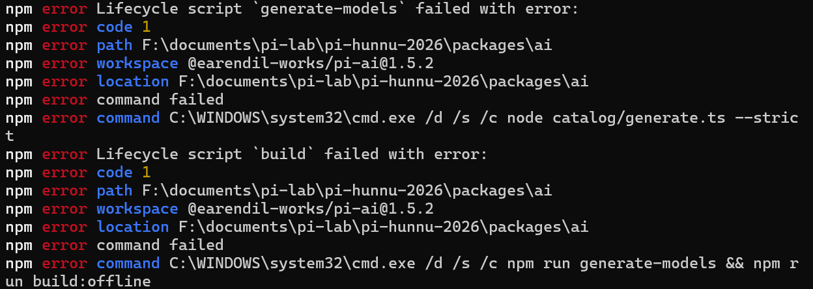

*图 S5-fail* `generate-models` *与* `build` *双层报错，均为* `npm error code 1`*，失败位置在* `packages/ai`*（*`@earendil-works/pi-ai@1.5.2`*）。*

前 6 段（`telemetry`、`schema`、`chord`、`tui`、`codemode`、`mcp`）编译正常，在第 7 段 `ai` 的 `generate-models` 步骤失败。日志中的真正病因为联网取数超时：

```
Fetching models.dev catalog...
Failed to fetch models.dev catalog: [TypeError: fetch failed]
ConnectTimeoutError: Connect Timeout Error (attempted addresses: 172.67.220.122:443, 104.21.51.36:443, timeout: 10000ms)
```

### 2. 定位与解决

`packages/ai/catalog/sources/index.ts` 用 Node 自带 `fetch`（undici 实现）向 models.dev 等上游源取模型目录，而 `generate-models` 以 `--strict` 运行——该模式下任意一个源失败就直接 throw，因此整条根构建链在 `ai` 处断裂，后面 `durable`、`env`、`agent`、`coding-agent` 四段根本没有执行。

失败原因是 Node 的 `fetch` **默认不读取 Windows 系统代理，也不读取** `HTTP_PROXY` **/** `HTTPS_PROXY` **环境变量**，而是直连；直连这两个 Cloudflare 地址在本网络下 10 秒超时。解决办法是在同一终端会话中显式打开 Node 的环境代理开关，再跑构建：

```powershell
$env:HTTP_PROXY  = "http://127.0.0.1:7890"
$env:HTTPS_PROXY = "http://127.0.0.1:7890"
$env:NODE_USE_ENV_PROXY = "1"
```

先做一次定点验证，确认 Node 侧真的走上了代理：

```powershell
node -e "fetch('https://models.dev/api.json').then(r=>console.log('status',r.status)).catch(e=>console.log('ERR',e.cause?.code||e.message))"
```

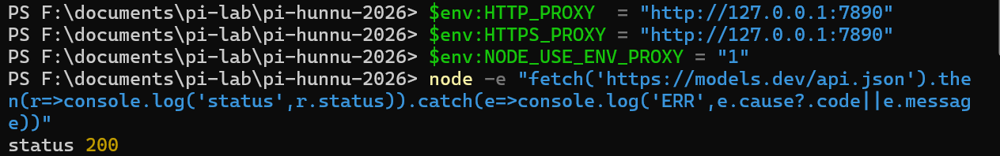

*图 S5-proxy-check 三个环境变量设置后，*`fetch` *返回* `status 200`*。*

这一步很关键：它把“网络不通”和“Node 没认代理”区分开了——如果此处不是 200，说明问题在代理规则或代理本身，而不是 Node 配置。

### 3. 重新构建成功

```powershell
npm run build
$LASTEXITCODE
```

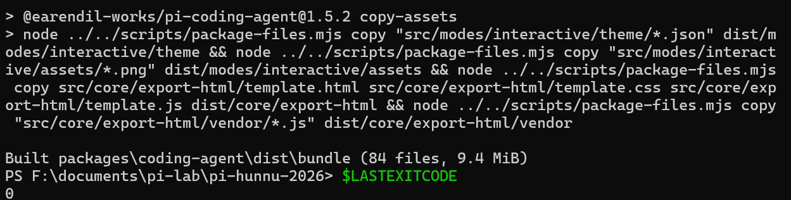

*图 S5-build 最后一段为* `coding-agent` *的* `copy-assets`*，结尾输出* `Built packages\coding-agent\dist\bundle (84 files, 9.4 MiB)`*，随后* `$LASTEXITCODE` *为* `0`*。*

`ai` 的 `generate-models` 这次成功拉取目录数据并生成 `src/providers/data`（此前该目录不存在，生成后共 44 个 JSON 文件），`durable`、`env`、`agent`、`coding-agent` 依次构建完成。这也说明了首次构建与后续构建的区别：`npm run build` **必须联网生成模型目录数据；**`src/providers/data` **是被 git 忽略的目录，新克隆的仓库里没有它**，而 `build:offline` 第一步 `check:model-data` 校验的正是这个目录，所以失败后不能改成 `build:offline` 绕过——那会因为数据缺失而继续失败。

### 4. 检查并运行构建产物

```powershell
Test-Path .\packages\coding-agent\dist\bundle\cli.js
node .\packages\coding-agent\dist\bundle\cli.js --version
```

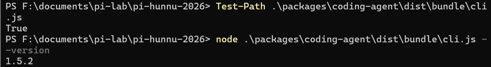

*图 S5-verify* `Test-Path` *输出* `True`*，*`node ...cli.js --version` *输出* `1.5.2`*。*

版本号 `1.5.2` 与任务六界面横幅一致，说明源码树与 `dist` 产物是同一版本。`dist` 只是构建输出目录：以后修改程序应改 `src`，再重新构建；直接改 `dist` 里的文件会被下一次构建覆盖。首次构建成功后，模型目录数据已就绪且仍有效时，可改用 `npm run build:offline` 复用数据，但它不是首次安装或首次数据初始化的替代命令。

---

## 六、任务六 启动本地源码版本并完成一次会话

### 1. 源码入口与启动

在仓库根目录执行 `.\pi-test.bat`。脚本名里带 `test`，但它是运行本地源码的入口，不是执行整个测试套件：当前版本的 `.bat` 调用同名 `.ps1`，由 Node 加载源码解析器并运行 `packages/coding-agent/src/cli.ts`。

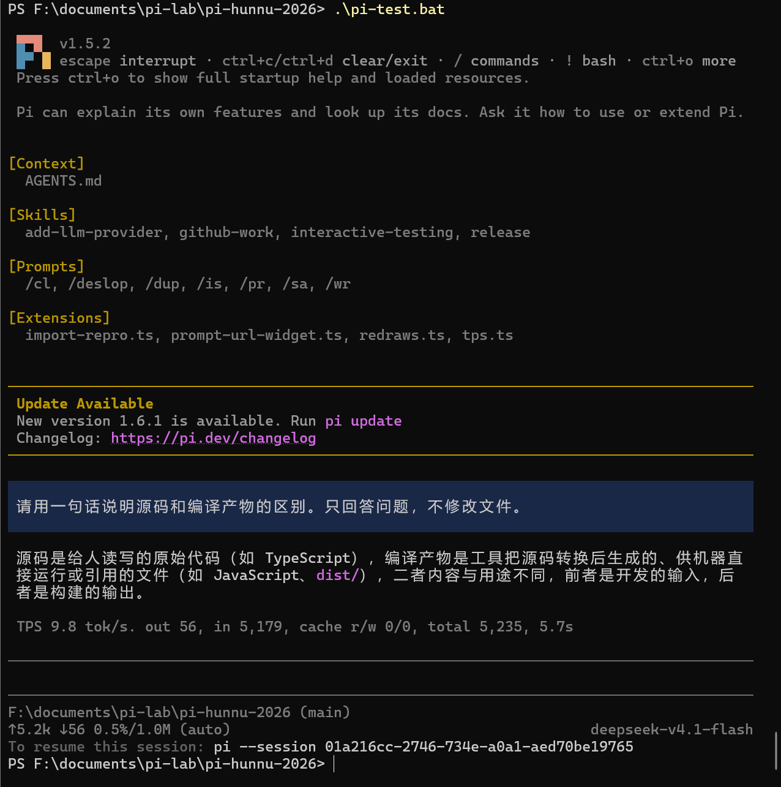

*图 S6-exit 顶部为* `PS F:\documents\pi-lab\pi-hunnu-2026> .\pi-test.bat`*，界面横幅显示 v1.5.2 并列出* `AGENTS.md`*、Skills、Prompts、Extensions；中部为本次提示词与模型回复；底部为退出摘要* `F:\documents\pi-lab\pi-hunnu-2026 (main)`*、*`To resume this session: pi --session ...` *以及退回后的提示符。*

启动时界面加载的 `AGENTS.md`、`.pi/skills`、`examples/extensions` 都来自这棵源码树，而不是全局安装目录，这一点可以佐证运行的是本地源码。

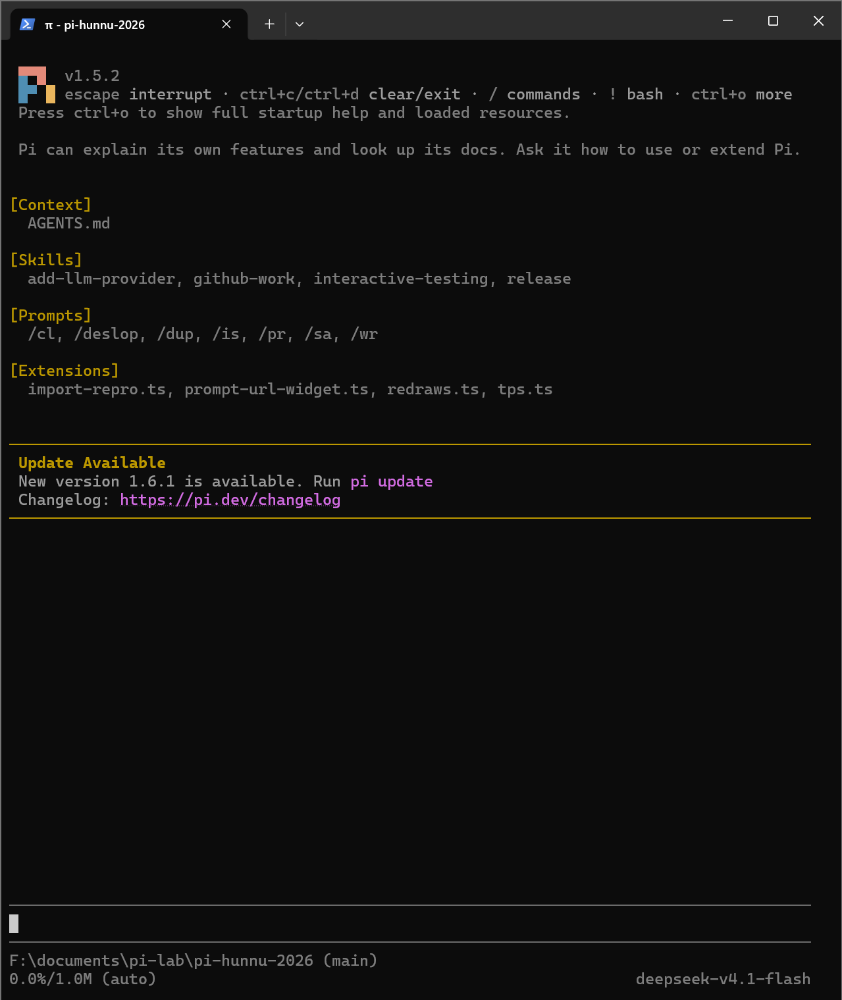

*图 s6-launch-ui 进入交互界面后的首屏：横幅显示 v1.5.2 与快捷键提示，下方列出本次从源码树加载的* `AGENTS.md`*、Skills、Prompts、Extensions，底部状态行为* `F:\documents\pi-lab\pi-hunnu-2026 (main)` *与* `0.0%/1.0M (auto)`*。*

### 2. 一次完整会话

发送作业指定问题：

```text
请用一句话说明源码和编译产物的区别。只回答问题，不修改文件。
```

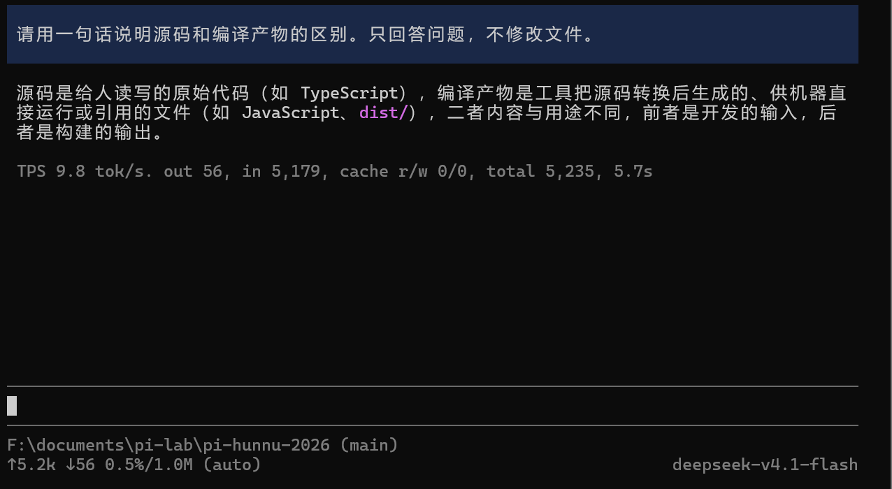

*图 S6-chat 底部状态行显示工作目录、上下文余量（*`0.5%/1.0M`*）与当前模型，上方为提示词和模型回复；回复正文为：“源码是给人读写的原始代码（如 TypeScript），编译产物是工具把源码转换后生成的、供机器直接运行或引用的文件（如 JavaScript、dist/），二者内容与用途不同，前者是开发的输入，后者是构建的输出。”*

确认为模型真实回复（带 token 统计 `TPS 9.8 tok/s`、`total 5,235`、耗时 `5.7s`），不是本地硬编码文本。

### 3. 两个入口的分工

- **源码入口** `.\pi-test.bat`：直接加载 `packages/coding-agent/src/cli.ts`，改动 `src` 后无需构建即可生效，适合开发调试；它复用当前用户配置目录 `~/.pi/agent`，所以第一次实践课已完成登录且凭据有效时无需重新登录——这表示复用了用户配置，并不表示运行的是全局安装版本。
- **产物入口** `node .\packages\coding-agent\dist\bundle\cli.js`：运行打包后的单文件产物，用于验证构建结果本身可独立运行，也是发布形态的入口。

**本次如何确保运行的是本地源码：** 命令是仓库根目录下的 `.\pi-test.bat`，其内部路径锚定在本次克隆的目录并指向 `src/cli.ts`；界面横幅版本 `1.5.2` 与 `dist` 产物 `--version` 输出一致；启动时加载的 `AGENTS.md`、Skills、Extensions 均来自该仓库。直接输入 `pi` 可能启动第一次实践课安装的全局版本，无法单独证明这一点，因此本次没有使用 `pi`。

---

## 七、本次遇到的困难与解决过程（重点）

**现象。** 首次执行 `npm run build` 在第 7 段 `ai` 中止，`npm error code 1`，`$LASTEXITCODE` 为 1。日志停在 `Fetching models.dev catalog...`，报 `fetch failed`，`ConnectTimeoutError` 指向 `172.67.220.122:443` 与 `104.21.51.36:443`，10 秒超时。前 6 段已编译成功，说明工具链本身没问题。

**定位依据。** 一是失败点位置明确：报错路径是 `packages/ai`，命令是 `node catalog/generate.ts --strict`；二是查源码确认取数方式：`catalog/sources/index.ts` 用 Node 原生 `fetch` 访问 models.dev、OpenRouter、Vercel AI Gateway 等源，且 `--strict` 下任一源失败即 throw；三是排除了“浏览器能打开就是网络没问题”的误判——浏览器走系统代理，Node 的 `fetch` 默认直连，两者路径不同。本机系统代理为 `127.0.0.1:7890` 且端口在监听，所以问题落在“Node 未使用代理”，而不是“网络不可达”。

**解决。** 在构建所用的终端会话内设置 `HTTP_PROXY`、`HTTPS_PROXY` 为 `http://127.0.0.1:7890`，并设置 `NODE_USE_ENV_PROXY=1`（Node 24 提供的环境代理开关），让 `fetch` 遵循这两个变量。

**验证。** 先用单点请求验证，而不是直接重跑全量构建：

```powershell
node -e "fetch('https://models.dev/api.json').then(r=>console.log('status',r.status)).catch(e=>console.log('ERR',e.message))"
```

返回 `status 200`（图 S5-proxy-check）。随后重跑 `npm run build`，日志走完 11 段并以 `Built packages\coding-agent\dist\bundle (84 files, 9.4 MiB)` 结束，`$LASTEXITCODE` 为 0（图 S5-build）。

**为什么不能改走** `build:offline`**。** 失败后最容易想到“跳过联网步骤”，但这条路不成立：`build:offline` 的第一步是 `check:model-data`，它校验的 `src/providers/data` 是被 git 忽略的目录，全新克隆里根本不存在，而唯一能生成它的正是 `generate-models`。所以首次构建必须联网成功执行一次，离线构建只适用于数据已就绪的后续重建。

**经验。** 遇到 `fetch failed` 这类报错，先分辨“请求发出去了但被服务端拒绝”和“连接根本没建立”：前者通常会带回 4xx/5xx 状态码，后者是 `ECONNREFUSED`、`UND_ERR_CONNECT_TIMEOUT` 这类传输层错误。本次属于后者。另一条经验是**先做十秒级的单点验证再跑长任务**，能在几秒内判断修复是否生效，避免每轮都等几分钟。

---

## 八、附件清单

所有截图与源文件均在本目录下。

| 文件 | 说明 | 对应要求 |
| --- | --- | --- |
| `images/s1-versions.png` | `Test-Path`、node v24.14.1、npm 11.11.0、git 2.51.1、`Hello, Node.js!` | S1 |
| `images/s2-repo-info.png` | 本地路径、origin、分支 main、commit c3cc916…、工作区干净 | S2 |
| `images/s3-engines.png` | 根 `package.json` 第 69–71 行 `engines.node` | S3 |
| `images/s3-build-script.png` | 根 `package.json` 的 `scripts.build` 与 `build:offline` | S3 |
| `images/s4-install.png` | `npm install --ignore-scripts` 输出与 `$LASTEXITCODE`=0 | S4 |
| `images/s5-build-fail.png` | 首次构建在 `ai` 段失败，双层 `npm error code 1` | S5 / 困难 |
| `images/s5-proxy-check.png` | 代理变量设置与 `status 200` 验证 | 困难与解决 |
| `images/s5-build-success.png` | 构建成功结尾与 `$LASTEXITCODE`=0 | S5 |
| `images/s5-verify.png` | `Test-Path` True 与产物版本 `1.5.2` | S5 |
| `images/s6-launch-ui.png` | Pi 界面：v1.5.2 横幅、Context、Skills、Prompts、Extensions | S6 |
| `images/s6-chat.png` | 本次提示词与模型实际回复 | S6 |
| `images/s6-launch-context.png` | `.\pi-test.bat` 启动命令、界面、回复、退出摘要与提示符 | S6 |

---

## 九、结论

- 源码位置：`F:\documents\pi-lab\pi-hunnu-2026`，分支 `main`，commit `c3cc91632d0a1950fb122605b190233f2aa0006e`。
- 依赖位置：仓库根目录 `node_modules`，由 npm workspaces 统一链接各子包，共安装 335 个包。
- 构建执行了什么：根 `scripts.build` 依次调用 11 个子包的 `build`，主要是 `tsc -p tsconfig.build.json` 的 `src → dist` 编译，外加 `ai` 的模型目录生成/复制与 `coding-agent` 的资源拷贝与打包。
- 正在运行哪个版本：1.5.2，源码入口 `.\pi-test.bat` 与产物入口 `dist\bundle\cli.js --version` 一致。
- 本次未构建独立 EXE，也未部署任何大模型权重；首次构建中的联网仅用于获取模型目录配置数据。

---

## 十、参考

- 课程仓库：https://github.com/hunnuOpenSourceSoftware2026/pi-hunnu-2026
- 小组 fork 仓库：https://github.com/star091221/pi-hunnu-2026
- 根 `package.json`（`engines`、`workspaces`、`scripts`）、`package-lock.json`
- `packages/ai/catalog/sources/index.ts`、`packages/ai/catalog/generate.ts`、`packages/ai/package.json`
- `packages/coding-agent/package.json`、`pi-test.bat`、`pi-test.ps1`
- npm 文档：`npm install --ignore-scripts`（https://docs.npmjs.com/cli/v11/commands/npm-install/）