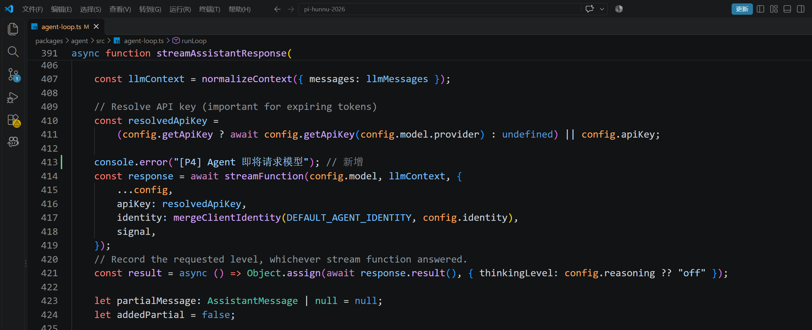
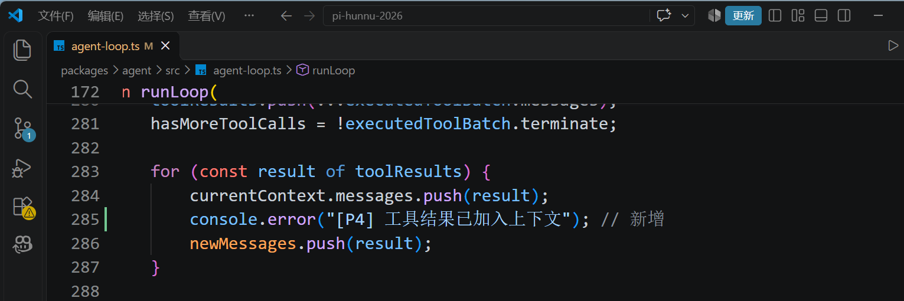
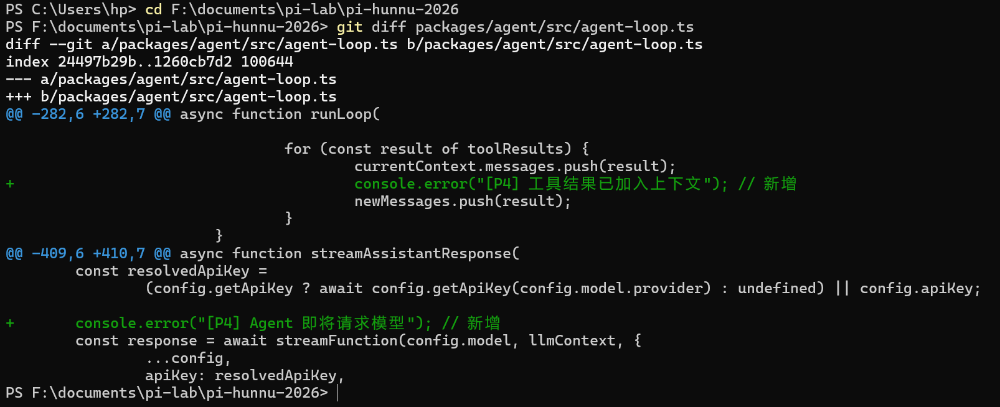
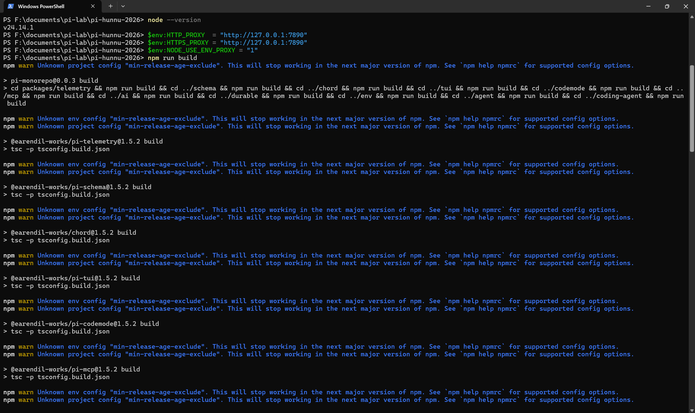
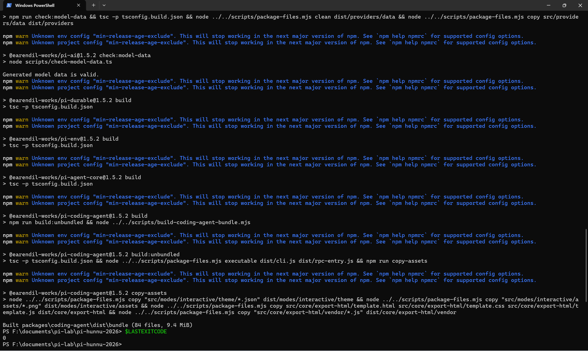
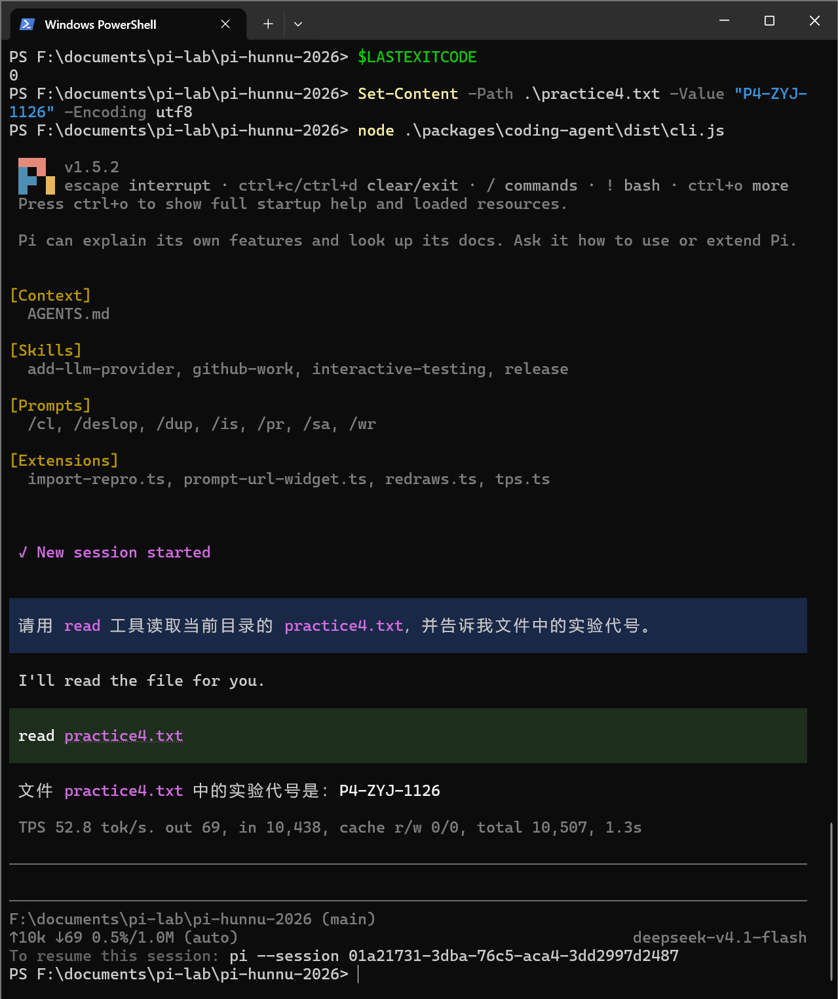
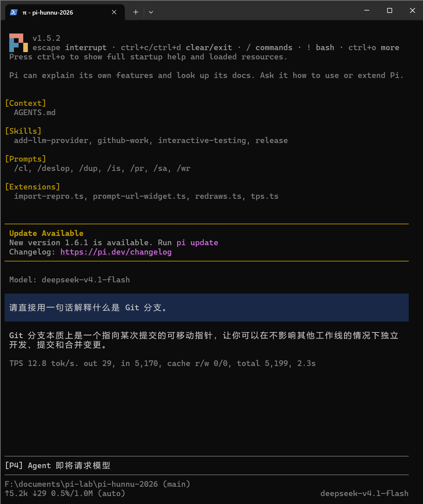
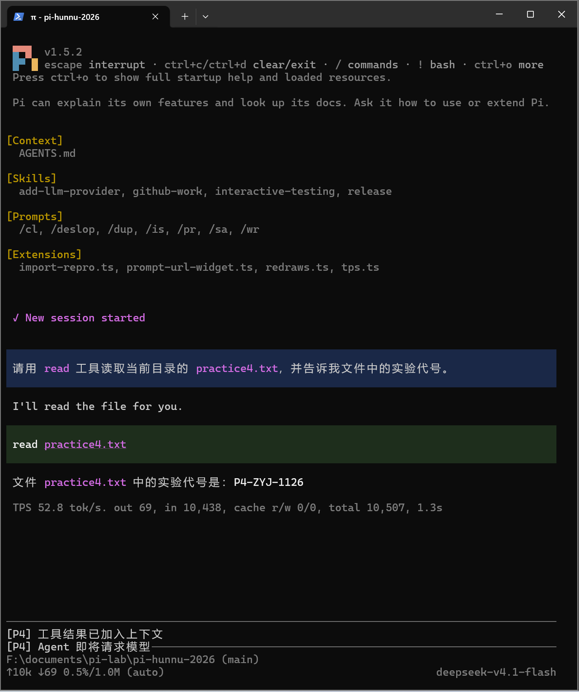
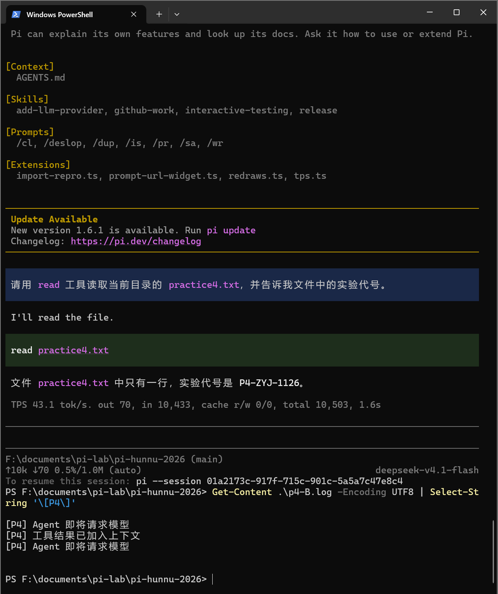

# 实践课4：Pi Agent 的模型调用与运行流程

| 项目 | 内容 |
| --- | --- |
| 姓名 / 学号 | 周怡君 / 202430224042 |
| 小组代码仓库 | https://github.com/star091221/pi-hunnu-2026 |
| 本地源码路径 | `F:\documents\pi-lab\pi-hunnu-2026` |
| 源码 commit | c3cc91632d0a1950fb122605b190233f2aa0006e |
| 分支 | main |
| Node.js | v24.14.1 |
| 终端 | Windows PowerShell 5.1 |
| 运行入口 | `node .\packages\coding-agent\dist\cli.js`（v1.5.2） |
| 使用模型 | `hunnu/deepseek-v4.1-flash` |
| 实验代号 | `P4-ZYJ-1126` |

---

## 一、任务一 给 Agent 循环加两行日志

两处修改都在 `packages/agent/src/agent-loop.ts`，行号与教师演示版本一致（原 412 行、原 284 行）。按课件建议**先改靠后的第 412 行、再改第 284 行**，这样第一处插入不会把第二处的目标行向下顶一格。

### 1. 模型调用前打印日志（第 413 行）

在 `const response = await streamFunction(config.model, llmContext, {` 的**上方**插入一行：

```ts
	console.error("[P4] Agent 即将请求模型"); // 新增
	const response = await streamFunction(config.model, llmContext, {
		...config,
```



*图 S1：标签页与面包屑确认文件为* `packages/agent/src/agent-loop.ts`*，第 413 行为新增日志（左侧绿色竖条），第 414 行紧接着* `const response = await streamFunction(...)`*。*

### 2. 工具结果加入上下文后打印日志（第 285 行）

在 `for (const result of toolResults)` 循环内、`currentContext.messages.push(result);` 的**下方**插入一行：

```ts
	for (const result of toolResults) {
		currentContext.messages.push(result);
		console.error("[P4] 工具结果已加入上下文"); // 新增
		newMessages.push(result);
	}
```



*图 S2：第 283–286 行完整呈现 for 循环、*`currentContext.messages.push(result)`*、新增日志与* `newMessages.push(result)`*。*

### 3. 差异汇总

```diff
@@ -282,6 +282,7 @@ async function runLoop(
 	for (const result of toolResults) {
 		currentContext.messages.push(result);
+		console.error("[P4] 工具结果已加入上下文"); // 新增
 		newMessages.push(result);
 	}
@@ -409,6 +410,7 @@ async function streamAssistantResponse(
 	const resolvedApiKey =
 		(config.getApiKey ? await config.getApiKey(config.model.provider) : undefined) || config.apiKey;
+	console.error("[P4] Agent 即将请求模型"); // 新增
 	const response = await streamFunction(config.model, llmContext, {
```



*图 D1：*`git diff` *只有两个 hunk，各新增一行；*`git diff --numstat` *输出* `2 0`*，即 2 行新增、0 行删除，未触碰其他代码，工作区仅* `packages/agent/src/agent-loop.ts` *一处为修改状态。*

---

## 二、任务二 重新编译并启动

### 1. 构建

```powershell
cd F:\documents\pi-lab\pi-hunnu-2026
node --version
$env:HTTP_PROXY  = "http://127.0.0.1:7890"
$env:HTTPS_PROXY = "http://127.0.0.1:7890"
$env:NODE_USE_ENV_PROXY = "1"
npm run build
$LASTEXITCODE
```

三个代理变量是为防止 `ai` 段取数时 Node 的 `fetch` 直连超时而提前设好的（见第五节）。本次 `ai` 段实际执行的是 `npm run check:model-data`，输出 `Generated model data is valid`，模型目录数据已就绪，未触发联网。



*图 S3a：*`node --version` *为 v24.14.1，三个代理变量就位，*`npm run build` *从* `telemetry` *开始按 11 段依次构建。*



*图 S3b：构建走到* `coding-agent` *段，结尾为* `Built packages\coding-agent\dist\bundle (84 files, 9.4 MiB)`*，*`$LASTEXITCODE` *输出* `0`*。*

构建产物时间戳可交叉验证改动确实被编译进去：`packages/agent/dist/agent-loop.js` 为 17:04:05，晚于源码保存时间，且该文件中同时含两条 `[P4]` 日志。

### 2. 启动

```powershell
node .\packages\coding-agent\dist\cli.js
```



*图 S4：同一屏内自上而下依次是* `Set-Content ... practice4.txt`*、*`node .\packages\coding-agent\dist\cli.js`*、v1.5.2 横幅与* `[Context]/[Skills]/[Prompts]/[Extensions]` *加载列表，以及退出时的* `To resume this session: pi --session ...` *与返回的命令提示符。*

---

## 三、任务三 对比两次运行

实验文件建在仓库根目录，代号留在文件中，第二条指令只给文件名：

```powershell
$enc = New-Object System.Text.UTF8Encoding($false)
[System.IO.File]::WriteAllText("$PWD\practice4.txt", "P4-ZYJ-1126", $enc)
```

### 1. 会话 A：直接问答

- 输入指令：`请直接用一句话解释什么是 Git 分支。`
- 是否调用工具：**否**
- 实际日志（按出现顺序，共 1 条）：

```text
[P4] Agent 即将请求模型
```

- 模型调用轮数：**1 轮**
- 最终回复：Git 分支本质上是一个指向某次提交的可移动指针，让你可以在不影响其他工作线的情况下独立开发、提交和合并变更。
- 真实调用佐证：`TPS 12.8 tok/s. out 29, in 5,170, cache r/w 0/0, total 5,199, 2.3s`



*图 S5：模型为* `deepseek-v4.1-flash`*，中部为指令与回复，底部仅一条* `[P4] Agent 即将请求模型`*，说明整轮只到达一次模型调用位置、没有任何工具结果回填。*

### 2. 会话 B：读取文件

用 `/new` 起新会话，模型保持不变。

- 输入指令：`请用 read 工具读取当前目录的 practice4.txt，并告诉我文件中的实验代号。`
- 是否调用工具：**是**，工具名 `read`，参数指向 `practice4.txt`
- 读到的实验代号：`P4-ZYJ-1126`
- 模型调用轮数：**2 轮**
- 最终回复：文件 practice4.txt 中只有一行，实验代号是 P4-ZYJ-1126。
- 上下文变化：`in` 从会话 A 的 5,170 增至 10,433，方向与“多带了一条工具结果”一致



*图 S6a：新会话标记* `✓ New session started`*、指令、*`read practice4.txt` *的绿色工具块、返回的实验代号，以及屏上可见的后两条日志：*`[P4] 工具结果已加入上下文` *→* `[P4] Agent 即将请求模型`*。终端日志区在退出时会被清空，屏上保留不下完整序列，故补 S6b。*

完整日志按出现顺序抄录如下（取自同一实验的第二遍运行，stderr 重定向落盘后读取）：

```text
[P4] Agent 即将请求模型
[P4] 工具结果已加入上下文
[P4] Agent 即将请求模型
```



*图 S6b：同一次会话（指令、*`read practice4.txt`*、代号* `P4-ZYJ-1126` *与最终回复均在画面内），退出后执行* `Get-Content .\p4-B.log -Encoding UTF8 | Select-String '\[P4\]'`*，完整输出三行日志，顺序为“请求模型 → 工具结果入上下文 → 再次请求模型”。*

---

## 四、运行流程对比

| 对比项 | 会话 A：直接问答 | 会话 B：读取文件 |
| --- | --- | --- |
| 是否调用工具 | 否 | 是，`read` |
| “即将请求模型”条数 | 1 | 2 |
| “工具结果已加入上下文”条数 | 0 | 1 |
| 模型调用轮数 | 1 | 2 |
| 上下文规模（`in`） | 5,170 | 10,433 |

### 1. 谁实际读了文件

读文件的是 **Pi 本地进程中的** `read` **工具**（实现位于 `packages/coding-agent/src/core/tools/read.ts`），不是模型。模型本身没有文件系统访问能力，它只是输出一条 `tool_call`（图中绿色的 `read practice4.txt` 就是这次调用的渲染），由 Agent 循环在本地执行该工具，再把读到的内容送回模型。

### 2. 下一轮模型请求多带了什么

多带了两条消息：一条 assistant 消息，携带指向 `practice4.txt` 的 `tool_call`；一条 `role: tool` 的工具结果消息，内容是文件正文（即实验代号 `P4-ZYJ-1126`）。会话 B 第二轮的 `llmContext` 因此比第一轮长，`in` 从 5,170 涨到 10,433 即是这一增长在计费统计上的体现。

### 3. 两类日志各记录什么

- `[P4] Agent 即将请求模型` 打在 `streamAssistantResponse` 里 `streamFunction` 调用之前，记录 Agent 到达一次模型调用的位置。会话 A 只有这一条，说明整轮只请求了一次；会话 B 出现两次，说明请求了两次。
- `[P4] 工具结果已加入上下文` 打在 `for (const result of toolResults)` 循环内，每写入一条工具结果打印一次。它出现在两条“即将请求模型”之间，正好标出循环的后半段：工具执行完 → 结果回填 → 再发起下一次请求。

会话 A 的日志只有一行，是因为没有工具调用，循环直接走“请求 → 回复 → 结束”；会话 B 则走满了“请求 → 工具调用 → 工具结果回填 → 再请求 → 回复”的完整一圈。

### 4. 组件简图

```text
       ┌───────────────────────────────────────────────┐
       │ coding-agent（packages/coding-agent）          │
       │  CLI 入口 cli.js、交互界面、read 等工具实现       │
       └──────────────────────┬────────────────────────┘
                              │ 传入 AgentConfig：model、tools、convertToLlm
                              ▼
       ┌───────────────────────────────────────────────┐
       │ agent（packages/agent · agent-loop.ts）        │
       │  决定何时请求模型、执行工具、把结果写回 messages    │
       └──────────────────────┬────────────────────────┘
                              │ streamFunction(config.model, llmContext)
                              ▼
       ┌───────────────────────────────────────────────┐
       │ ai（packages/ai）                              │
       │  拼装 HTTP 请求、解析流式响应                    │
       └──────────────────────┬────────────────────────┘
                              │ HTTPS
                              ▼
       ┌───────────────────────────────────────────────┐
       │ 远程模型服务 models.hunnu.edu.cn                │
       │  hunnu/deepseek-v4.1-flash                    │
       └───────────────────────────────────────────────┘
```

---

## 五、遇到的困难与解决

### 1. 日志重定向后中文乱码

**现象。** 为拿到完整的三行日志，执行 `node .\packages\coding-agent\dist\cli.js 2> p4-B.log`，再用 `Get-Content .\p4-B.log | Select-String '\[P4\]'` 查看，输出全是 `[P4] Agent 鍭鈥嘫鐃...` 这样的乱码，且第一行被包装成 `node : ... + CategoryInfo : NotSpecified ... NativeCommandError` 的错误记录。

**原因。** 本机终端是 Windows PowerShell 5.1（标签页显示 `Windows PowerShell`）。5.1 在执行 `2>` 重定向时，会先按控制台代码页（936）把子进程的 stderr 解码，再写文件，Node 写出的 UTF-8 中文在这一趟转码里被拆坏；同时 PowerShell 会把 native 命令的错误流包装成 `ErrorRecord`，于是文件里混进了 `CategoryInfo`、`FullyQualifiedErrorId` 这些与日志无关的行。

**解决。** 让 cmd 来做重定向：cmd 的 `>` 是句柄级直通，把子进程写出的字节原样落盘，不经过字符解码。

```powershell
del .\p4-B.log -ErrorAction SilentlyContinue
cmd /c "node .\packages\coding-agent\dist\cli.js 2> p4-B.log"
Get-Content .\p4-B.log -Encoding UTF8 | Select-String '\[P4\]'
```

改用 cmd 捕获后，三行日志中文完整、顺序正确，且不再有 `CategoryInfo` 之类的噪声（图 S6b）。

### 2. `practice4.txt` 带 UTF-8 BOM

Pi 在会话 B 中主动提示“文件带有一个 UTF-8 BOM，所以开头可能有不可见字符”。核查字节确认开头为 `EF BB BF`：PowerShell 5.1 的 `-Encoding utf8` 默认写入 BOM（7.x 才是不带 BOM 的语义）。

改为显式指定不带 BOM 的编码写入，文件首字节变回 `P`（0x50），Pi 也能干净地读出“只有一行”：

```powershell
$enc = New-Object System.Text.UTF8Encoding($false)
[System.IO.File]::WriteAllText("$PWD\practice4.txt", "P4-ZYJ-1126", $enc)
```

### 3. 预留代理变量

`npm run build` 的第 7 段 `ai` 涉及模型目录数据。Node 的 `fetch` 默认不读取 Windows 系统代理，也不读 `HTTP_PROXY`/`HTTPS_PROXY`，需要额外设置 `NODE_USE_ENV_PROXY=1` 才生效。本次数据已就绪、走的是 `check:model-data` 校验而未联网，但仍在同一终端里预先设好三个变量，避免中途因直连超时中断整条构建链。

---

## 六、结论

- 改动只有两行 `console.error`，`git diff --numstat` 为 `2 0`，编译后 `packages/agent/dist/agent-loop.js` 同时包含两条日志，运行 `dist/cli.js` 时可见。
- 会话 A（直接问答）不调用工具，只进入 1 轮模型调用，只出现 1 条“即将请求模型”。
- 会话 B（读取文件）调用 `read` 工具，进入 2 轮模型调用，日志顺序为“即将请求模型 → 工具结果已加入上下文 → 即将请求模型”。
- 读文件的是本地 `read` 工具，模型只负责发起 `tool_call` 与阅读返回内容；下一轮请求额外带上了包含文件正文的 `role: tool` 消息，这正是 Agent 循环“上下文累积”的具体表现。

---

## 七、附件清单

| 文件 | 说明 | 对应要求 |
| --- | --- | --- |
| `S1-agent-loop-413.png` | 第 413 行新增日志，紧跟 `await streamFunction` | S1 |
| `S2-agent-loop-285.png` | 第 285 行 for 循环内新增日志 | S2 |
| `D1-git-diff.png` | `git diff` 两个 hunk，`--numstat` 2 增 0 删 | 代码差异 |
| `S3a-build-env.png` | 构建命令、Node 版本、代理变量、第 1–6 段 | S3a |
| `S3b-build-exit0.png` | 构建结尾 `84 files, 9.4 MiB` 与 `$LASTEXITCODE` = 0 | S3b |
| `S4-launch-cli.png` | 启动命令、v1.5.2 界面、会话恢复提示 | S4 |
| `S5-session-a.png` | 会话 A 指令、回复、1 条日志 | S5 |
| `S6a-session-b-ui.png` | 会话 B 指令、`read` 记录、代号、屏上后两条日志 | S6a |
| `S6b-session-b-logs.png` | 会话 B 完整三行日志（落盘后读取） | S6b |
