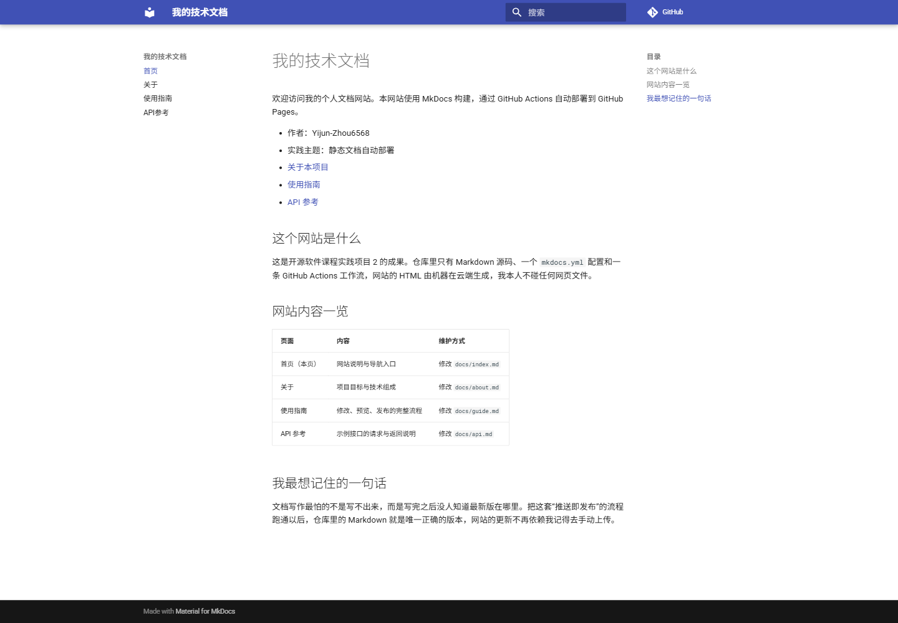
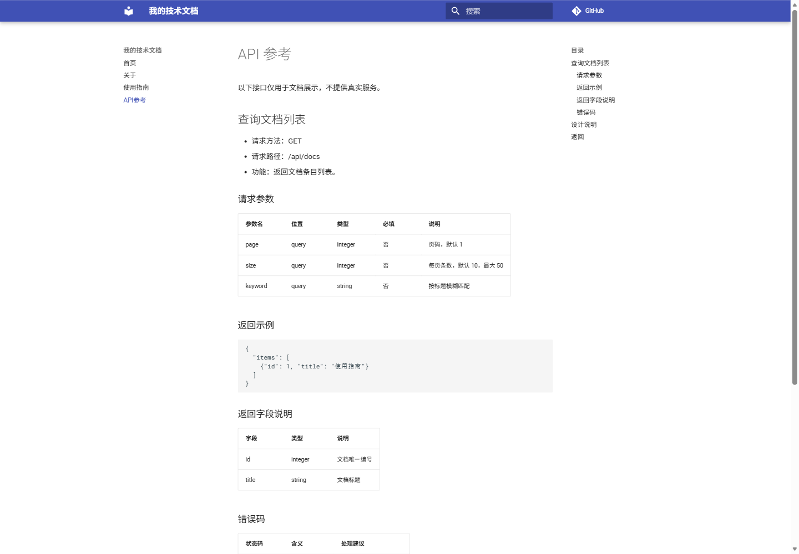
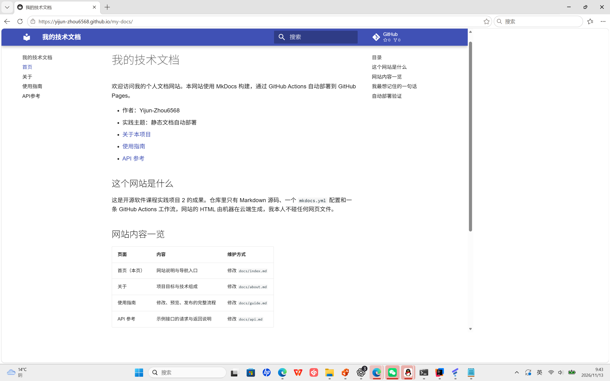
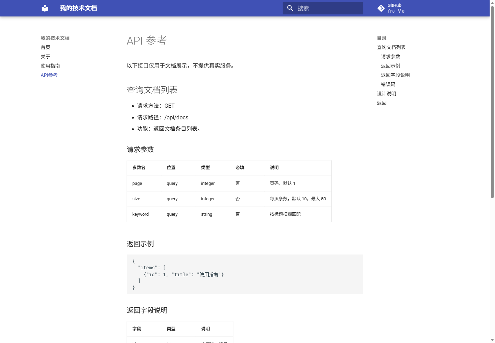
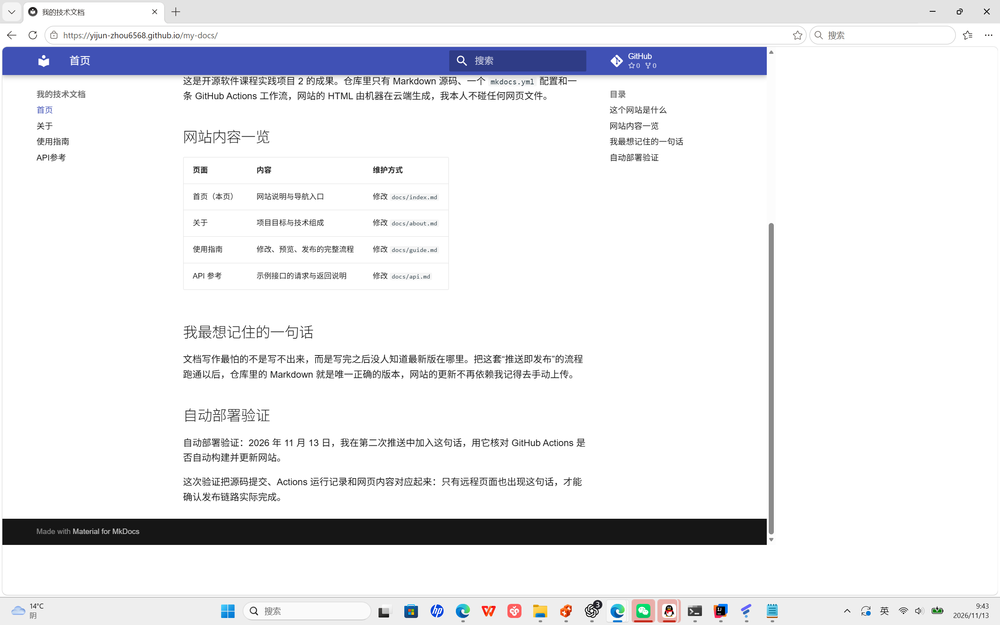

# 实践项目2：个人实验报告

## 1. 基本信息

- GitHub 登录名：Yijun-Zhou6568
- 个人仓库：[Yijun-Zhou6568/my-docs](https://github.com/Yijun-Zhou6568/my-docs)
- 最终网站：[我的技术文档](https://yijun-zhou6568.github.io/my-docs/)
- 实践时间：2026 年 11 月 9 日至 11 月 13 日。
- 发布方式：GitHub 官方 Pages Actions，构建产物直接上传发布。

本次实验使用 MkDocs Material 制作四页文档，通过 GitHub Actions 构建并部署到 GitHub Pages。在完成首次发布后，再修改首页并推送，检查网站能否自动更新。

## 2. 实践过程与关键截图

### 2.1 仓库创建

使用本人账号创建公开仓库 my-docs，将本地项目推送至 main 分支。仓库保存源码、配置和报告，生成的网站及本地虚拟环境由 .gitignore 排除。

仓库创建完成后，首页显示 Public 标识，默认分支为 main，项目文件已上传。

### 2.2 项目结构与 MkDocs 配置

- docs/ 保存首页、关于、使用指南和 API 参考四页 Markdown，是网站的内容源文件。
- mkdocs.yml 配置站点名、Material 中文主题、仓库地址、网站地址和导航。nav 的路径相对 docs/，应写 index.md，而不是 docs/index.md。
- site/ 保存构建生成的 HTML、CSS 和 JavaScript，下一次构建会覆盖，不作为手工维护的源码。
- report/ 单独保存说明和截图，不参与网站导航。
- .github/workflows/deploy.yml 定义安装、构建、上传产物和部署步骤。

截图展示实际文件树与配置。四个 nav 条目均有对应文档；.gitignore 忽略 site/、.venv/ 和 __pycache__/。

### 2.3 本地构建与预览

本地使用已安装依赖的 Python 3.13 虚拟环境进行预览，Actions 中配置 Python 3.12。先执行严格构建检查文档，再启动预览服务。

~~~powershell
# 在已经安装 requirements.txt 依赖的 Python 环境中执行
python -m mkdocs build --strict
python -m mkdocs serve -a 127.0.0.1:8026
~~~

本地预览地址为 http://127.0.0.1:8026/my-docs/ 。严格构建输出 Documentation built，程序正常结束。

四页均返回 200。首页、关于页有表格，使用指南、API 页有代码块，导航和页面间链接均有对应目标。

### 2.4 Pages 设置

进入 Settings → Pages，确认 Build and deployment 的 Source 为 GitHub Actions。设置页显示 Your site is live at 和实际网站地址。

工作流中，源码读取使用 contents: read 权限，部署任务使用 pages: write 和 id-token: write 权限。这些权限由工作流声明，不需要另外填写个人访问令牌。

### 2.5 首次构建和部署

首次源码提交为 [213d805](https://github.com/Yijun-Zhou6568/my-docs/commit/213d805a41bba4c8e297ff9a30ad1050e4ef382b)，对应运行创建于 2026 年 11 月 9 日。该运行经过重跑后成功，截图为重跑后的结果。

- [首次源码对应的成功运行](https://github.com/Yijun-Zhou6568/my-docs/actions/runs/42590596293)
- build、deploy 均为 success，依赖安装、严格构建、上传产物和发布均成功。

build 生成 site/ 并上传 github-pages artifact；deploy 通过 needs: build 等待构建成功后发布产物。分开两个任务，可以判断失败发生在构建阶段还是发布阶段。

### 2.6 公开网站与四页检查

2026 年 11 月 13 日通过浏览器逐页访问，结果如下。项目站点首页和子页均保留 /my-docs/ 路径。

| 页面 | 实际地址 | 检查结果 |
| --- | --- | --- |
| 首页 | https://yijun-zhou6568.github.io/my-docs/ | 200；作者、导航入口、表格及验证文字存在 |
| 关于 | https://yijun-zhou6568.github.io/my-docs/about/ | 200；项目目标、工具表和流程说明存在 |
| 使用指南 | https://yijun-zhou6568.github.io/my-docs/guide/ | 200；步骤、命令块和常见问题表存在 |
| API 参考 | https://yijun-zhou6568.github.io/my-docs/api/ | 200；参数表、JSON、字段说明和错误码存在 |

检查页面请求时，发现主题获取 GitHub 仓库信息的接口曾返回 403，查询最新 Release 的接口返回 404。本仓库没有创建 Release，这些请求不影响文档正文、导航和代码块显示。

### 2.7 第二次推送与自动更新验证

在 docs/index.md 增加“自动部署验证”一节，加入以下原文：

> 自动部署验证：2026 年 11 月 13 日，我在第二次推送中加入这句话，用它核对 GitHub Actions 是否自动构建并更新网站。

- 对应提交：[e43cfb5：验证文档修改后自动更新网站](https://github.com/Yijun-Zhou6568/my-docs/commit/e43cfb54547288bfb29520af0690556b7ecea765)
- 对应运行：[第二次 push 自动部署成功](https://github.com/Yijun-Zhou6568/my-docs/actions/runs/43345042522)
- 触发时间：2026 年 11 月 13 日 09:27（北京时间）。
- 事件：push。详情页显示 Triggered via push，未使用 Run workflow 手动触发。
- 结果：build、deploy 均成功，总时长约 32 秒。

部署成功后刷新首页，新增文字正常显示，与提交 e43cfb5 中的内容一致，自动更新验证完成。

## 3. 问题与解决

| 实际现象 | 关键记录 | 原因与处理 | 结果 |
| --- | --- | --- | --- |
| Pages 直接连接超时，推送曾失败 | ERR_CONNECTION_TIMED_OUT；Failed to connect to github.com port 443 | 当前网络直接连接不稳定；通过本机已有代理重试，未改动发布配置 | 网站返回 200，提交推送成功 |
| Actions 有提示但整体成功 | 部分动作的 Node.js 20 兼容提示；ubuntu-latest 迁移提示 | 检查注释与任务结论，保留课程的官方工作流 | build、deploy 均成功 |
| 主题附加仓库请求返回 403 | GitHub API 仓库及 releases/latest 查询 | 属于外部统计信息请求，与文档构建、托管分别判断 | 文档、表格和代码均可访问 |

第二次运行中，Checkout source、Set up Python、Configure Pages、Install dependencies、Build documentation、Upload site artifact 和 Deploy to GitHub Pages 均执行成功。

## 4. 原理理解

### 4.1 docs/ 和 site/ 各保存什么？为什么不用手工修改 site/？

docs/ 保存需要维护、提交的 Markdown。site/ 是根据源码、主题和配置生成的静态文件。修改产物会被下次构建覆盖，因此应修改 docs/ 后重新构建，site/ 不提交到 main。

### 4.2 本次工作流在什么情况下自动运行？

推送到 main，且涉及 docs/**、mkdocs.yml、requirements.txt 或 .github/workflows/deploy.yml 时自动运行。workflow_dispatch 额外提供手动入口，适合排错或重试，与第二次验证所用的 push 事件不同。

### 4.3 build 与 deploy 两个任务有什么区别？

build 读取源码、准备 Python 3.12、安装依赖、严格构建并上传 site/；deploy 通过 needs: build 等待构建成功，再以 pages: write、id-token: write 权限发布。github-pages 是记录部署状态和网站地址的环境。concurrency 的 pages 分组控制部署并发，避免多个发布互相干扰。

### 4.4 只修改 report/README.md 会触发部署吗？为什么？

不会。push.paths 不包含 report/ 或根 README.md，报告更新不改变网站源码，无需再次构建网站。

### 4.5 本次方案为何无需创建 gh-pages 分支？

upload-pages-artifact 上传静态文件，deploy-pages 直接将产物交给 Pages 托管，不需要写入另一条 Git 分支，因此 main 只保存源码即可。

## 5. 实验总结

通过本次实验，熟悉了从 Markdown 文档到公开网站的发布过程。文档内容放在 docs/ 中维护，GitHub Actions 负责生成和发布网站，修改内容后不需要再手动上传 HTML 文件。

排查问题时，需要把本地构建、云端部署和网络访问分开检查。例如，网站连接超时可能是网络问题，应先查看 Actions 是否成功，再检查网页访问情况。第二次推送后，运行记录和首页内容都发生了对应变化，说明自动部署配置已经生效。
