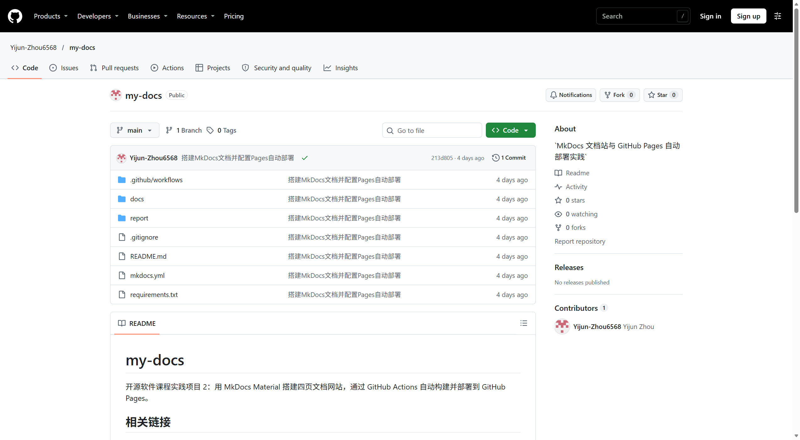
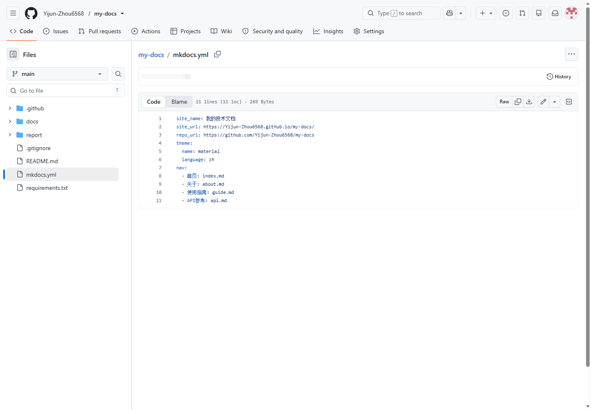
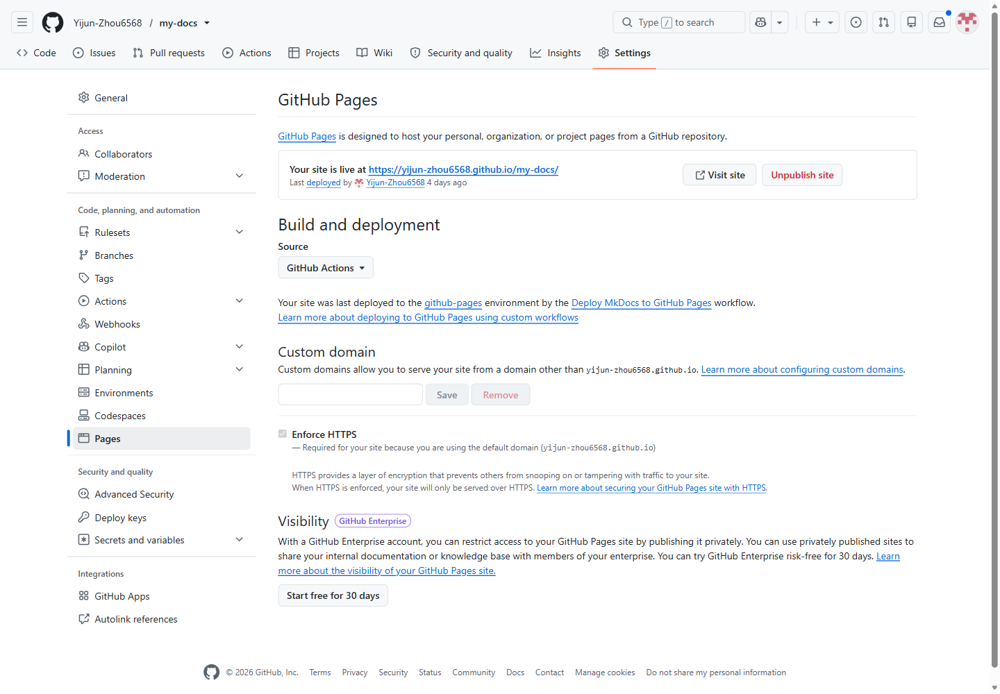
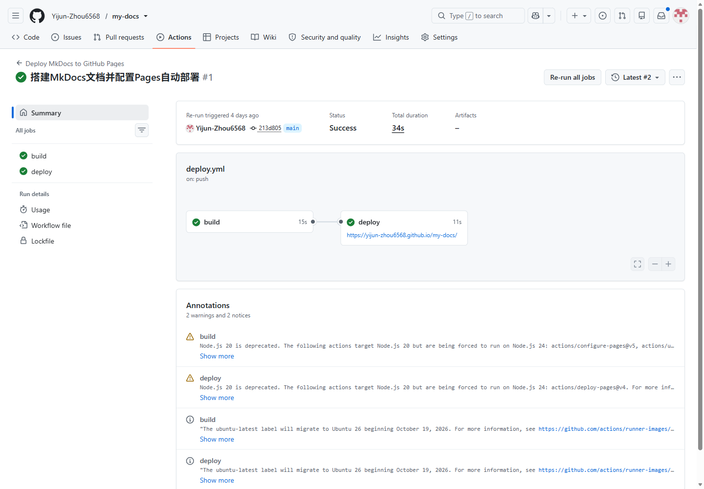
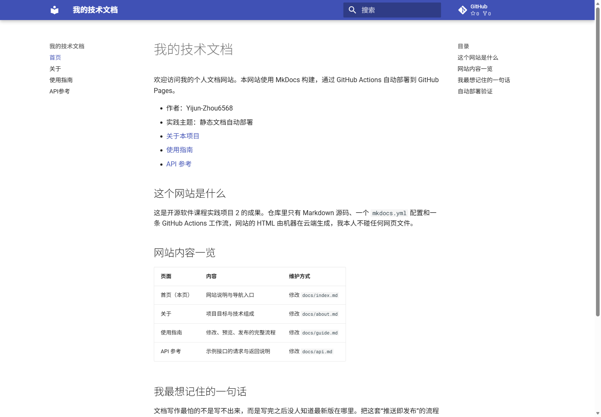
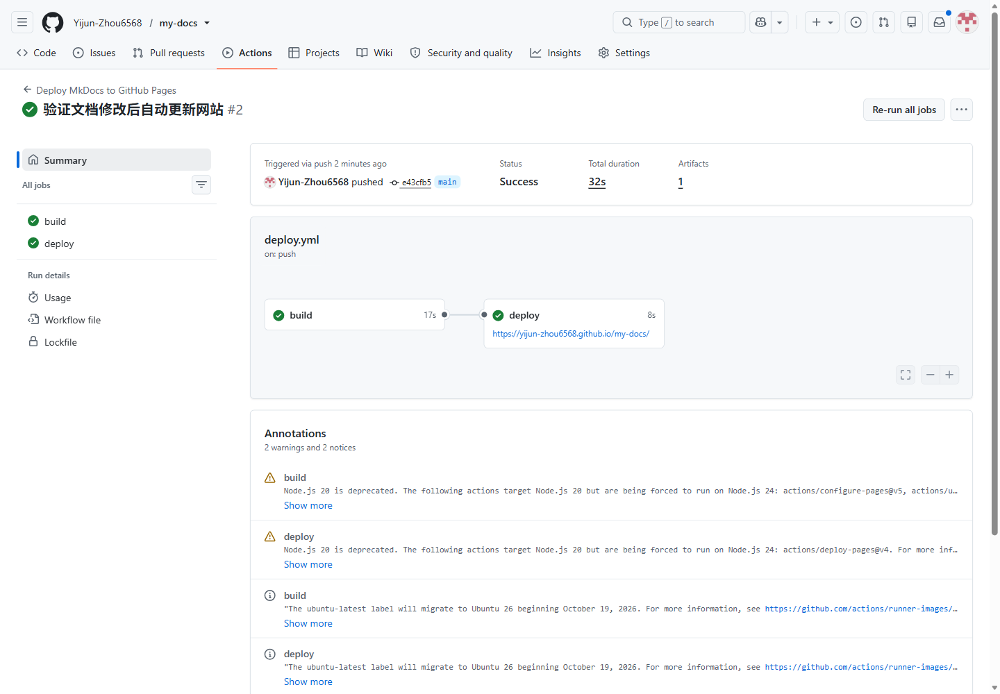

# 实践项目2：个人实验报告

## 1. 基本信息

- GitHub 登录名：Yijun-Zhou6568
- 个人仓库地址：https://github.com/Yijun-Zhou6568/my-docs
- 最终网站地址：https://Yijun-Zhou6568.github.io/my-docs/

## 2. 实践过程与关键截图

### 2.1 仓库创建

在 GitHub 网页右上角点击 `+` → New repository，Owner 选择本人账号，仓库名 `my-docs`，可见性选择 **Public**，不勾选初始化 README，创建后得到空仓库。之所以保持空仓库，是因为本地已经准备好了完整项目，先本地提交再推送可以避免远程初始提交与本地历史分叉。



结果：仓库首页可以看清所有者 `Yijun-Zhou6568`、仓库名 `my-docs` 和 Public 标识，默认分支为 `main`。

### 2.2 项目结构与 MkDocs 配置



三个目录的分工：

- `docs/` 是网站源码，四页 Markdown 都在这里，`nav` 中的路径相对它书写，因此写成 `index.md` 而不是 `docs/index.md`。
- `mkdocs.yml` 决定站点名称、主题与导航顺序，`site_url` 必须与最终 Pages 地址一致，否则站内链接和资源路径会出错。
- `site/` 是 `mkdocs build` 生成的构建产物，属于一次性输出，不手工编写也不提交，已在 `.gitignore` 中忽略。

### 2.3 本地构建或预览

```text
python -m venv .venv
.\.venv\Scripts\Activate.ps1
python -m pip install -r requirements.txt
python -m mkdocs build --strict
python -m mkdocs serve
```


`build --strict` 没有报出警告。本地预览时我检查了四项：导航栏四个条目都能跳转、表格边框与对齐正常、代码块高亮与 JSON 格式正常、页面底部的“返回”链接可点击。

### 2.4 Pages 设置

进入 Settings → Pages → Build and deployment → Source，选择 **GitHub Actions**。这一项是关键：发布来源一旦是分支，官方的 `deploy-pages` 动作会因为环境配置冲突而失败。



Actions 权限保持默认即可，工作流里已经单独声明了 `pages: write` 与 `id-token: write`，无需把仓库默认权限改成读写，也不需要勾选允许 Actions 创建和批准 PR。

### 2.5 Actions 首次构建和部署

推送后工作流自动触发，`build` 与 `deploy` 两个任务均为绿色。



### 2.6 网站访问与四页导航检查



四页均已逐一打开确认：首页、关于、使用指南、API 参考，导航顺序与 `nav` 一致，页面间链接可点击，表格和代码块显示正常。地址栏中保留了完整路径 `/my-docs/`，这是项目站点必须带的仓库路径。

### 2.7 第二次推送与自动更新验证

在 `docs/index.md` 末尾新增了一句可辨认的文字，提交后推送，未点击手动部署，工作流由这次 push 自动触发并成功。

- 对应提交：`<填写 commit 短哈希，如 a1b2c3d>`
- 对应 Actions 运行链接：`<填写本次运行记录地址>`



刷新网站后新文字出现，说明“推送 → 构建 → 部署 → 更新”整条链路可用。

## 3. 问题与解决

### 3.1 问题记录

| 现象 | 关键日志或报错 | 原因 | 解决操作 |
| --- | --- | --- | --- |
| （按实际情况填写；若未遇到错误，保留表格并写“本次运行未出现报错，核对过的日志见下方 3.2”） | | | |

### 3.2 未遇报错时核对过的内容

- `build` 任务中 `Install dependencies` 步骤无 `ERROR`，`Build documentation` 步骤输出 `INFO - Documentation built`，`--strict` 未中断。
- `deploy` 任务中 `Deploy to GitHub Pages` 步骤输出发布成功，并给出 `page_url`。
- 网站访问时浏览器控制台无 404 资源请求，说明资源路径与 `site_url` 匹配。

## 4. 原理理解

**1. `docs/` 和 `site/` 各保存什么？为什么不用手工修改 `site/`？**

`docs/` 保存人写的 Markdown 源码，是可维护、可版本管理的唯一源头；`site/` 是 `mkdocs build` 依据源码和配置生成的 HTML/CSS/JS 产物。产物由机器生成，手工修改会在下一次构建时被覆盖，也无法追溯改动，因此产物只用于发布，不进入版本库。

**2. 本次工作流在什么情况下自动运行？**

推送到 `main` 分支且改动涉及 `docs/**`、`mkdocs.yml`、`requirements.txt` 或 `.github/workflows/deploy.yml` 时自动运行；另外配置了 `workflow_dispatch`，可以在 Actions 页面手动触发，用于首次排错和重试。

**3. `build` 与 `deploy` 两个任务有什么区别？**

`build` 负责取源码、配置 Python 3.12、安装依赖、执行严格构建，并把 `site/` 打包成 artifact 上传；`deploy` 通过 `needs: build` 在构建成功后才启动，把 artifact 发布到 `github-pages` 环境并回写网站地址。前者只读代码，后者才真正写入 Pages，因此权限分开授予。

**4. 只修改 `report/README.md` 会触发部署吗？为什么？**

不会。工作流的 `paths` 只监听文档与配置路径，`report/` 不在列表内；报告属于过程记录，不影响网站内容，也就不需要重新构建发布。

**5. 本次方案为何无需创建 `gh-pages` 分支？**

官方 Pages Actions 方案把构建产物作为 artifact 直接交给 `deploy-pages` 发布，由 Pages 服务托管，产物不落在仓库分支上。这样省去维护 `gh-pages` 分支、以及在分支发布模式下所需的额外权限配置，仓库里只保留源码一条主线。

## 5. 提交信息

- 教师仓库 Issue 地址：`<填写本人提交的 Issue 链接>`
